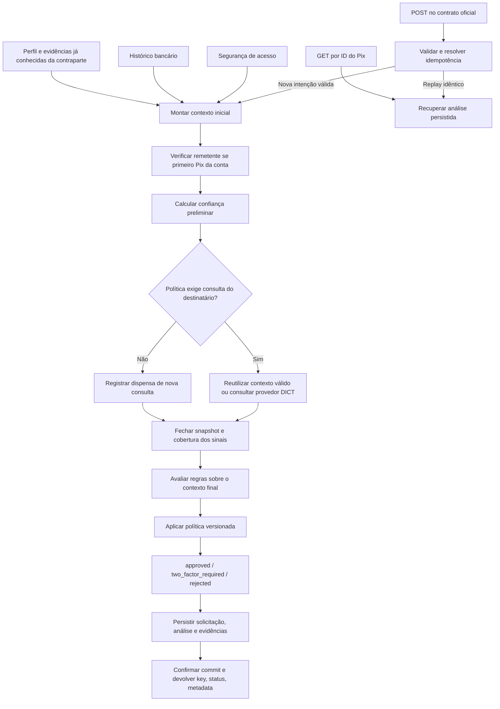

# Antifraude Pix: pesquisa e proposta consolidada para o hackathon

> **Guia vigente para o código:** [GUIA-IMPLEMENTACAO-ANTIFRAUDE-PIX.md](GUIA-IMPLEMENTACAO-ANTIFRAUDE-PIX.md), V3. A pedido do grupo, a proposta foi consolidada em um documento novo e autossuficiente, com política inicial explícita, persistência, 2FA, consultas condicionais, contrato e sequência de implementação. Os arquivos Python e o schema foram corrigidos e ganharam testes. Este documento permanece como pesquisa e histórico; alternativas e cortes em aberto abaixo são substituídos pelas decisões do guia. O registro de hipóteses retiradas continua no final dos documentos.

Atualizado em 17/10/2026 com o enunciado oficial, a orientação da organização sobre dados simulados, a política inicial de consultas ao DICT e a revisão da avaliação v2 e da Base API fornecidas pelo grupo. Documento de análise e proposta, anterior à implementação.

> **O que mudou nesta revisão — leitura rápida (17/10/2026)**
>
> **Novidade desta revisão:** a Base API do ZIP foi inspecionada e a avaliação v2 foi conferida com casos reproduzíveis. A estrutura da base e o schema são aproveitáveis; a simulação ainda tem falhas de frequência, confiança do aparelho, histórico e separação entre 2FA e execução. Leia o resumo da [revisão técnica](REVISAO-AVALIACAO-ANTIFRAUDE-PIX-v2.md). Os cortes de score e as mudanças de produto sugeridos pela outra LLM não foram promovidos a decisões do grupo.
>
> **Política de DICT preservada:** remetente apenas no primeiro Pix observado por conta; destinatário conforme coeficiente preliminar. A seção 6.5 detalha dados, cache, mocks e limites; os limiares continuam em aberto.
>
> Continua válida a orientação da organização, relatada pelo grupo, permitindo dados externos simulados e ideias probabilísticas. **O payload continua igual, mas deixou de limitar todas as informações que o motor pode usar.** Nenhum dos fluxos descritos está implementado nesta entrega.

| Tema | Antes | Agora / impacto prático | Onde ler |
| --- | --- | --- | --- |
| **Base API e avaliação v2** | Base exata pendente; política numérica ainda não definida | ZIP fornecido inspecionado; schema conferido na versão da base. Simulação reproduzida e problemas registrados, sem adotar seus cortes automaticamente | [Revisão técnica e evidências](REVISAO-AVALIACAO-ANTIFRAUDE-PIX-v2.md) |
| **DICT: quando consultar** | Reputação era uma possibilidade sem gatilho definido | Remetente apenas no primeiro Pix da conta; destinatário conforme confiança preliminar. Reutilizar contexto válido antes de uma nova chamada | [Política de consultas ao DICT](#mudancas-dict) |
| **Fontes de dados** | Apenas payload e histórico local | Podemos consultar mocks de sistemas bancários e bureaus para montar o contexto | [Catálogo de possibilidades](#mudancas-fontes) |
| **Resultado de 2FA** | Não sabíamos se o desafio havia sido concluído | Podemos consultar e persistir a confirmação; confiança contextual com escopo e validade pode evitar desafios repetidos durante uma viagem | [Fluxo de 2FA](#mudancas-2fa) |
| **Primeiro Pix na API** | Perfil local insuficiente | Histórico bancário simulado pode revelar valores habituais e destinatários recorrentes desde a primeira análise | [Política de pouco histórico](#mudancas-historico) |
| **Aparelho e acesso** | Só reconhecíamos o `device_id` já observado | Podemos distinguir S24 autorizado, aparelho revogado e recuperação de conta seguida de comportamento suspeito | [Catálogo de possibilidades](#mudancas-fontes) |
| **Destinatário** | Idade da conta e padrões observados localmente | Reputação, relacionamento prévio e perfil comercial ajudam a interpretar risco e evitar bloquear comerciantes por volume normal | [Catálogo de possibilidades](#mudancas-fontes) |
| **Contexto financeiro e outros sinais** | Sem saldo, limite efetivo ou telemetria | Limites personalizados, proporção do saldo, SIM swap e sinais de acesso passam a ser extensões possíveis | [Catálogo de possibilidades](#mudancas-fontes) |
| **Arquitetura e demonstração** | Contexto montado apenas com nossa base | Provedores simulados alimentam o mesmo motor; cenários pareados mostram o efeito de cada sinal, com snapshot e origem registrados | [Prioridades](#mudancas-prioridades) e [cenários](#mudancas-cenarios) |

**Prioridade proposta para o MVP:** segurança de acesso + histórico bancário + contraparte. Podem ser módulos com fixtures no mesmo serviço; não precisamos construir vários microserviços. Saldo, limites e sinais especializados ficam como extensões.

**Continuam valendo:** contrato público, três status, histórico próprio, regras explicáveis e idempotência. Sucesso de 2FA é registrado separadamente da análise original e não comprova pagamento executado. Dado simulado deve ser identificado como tal; ausência de informação não significa confiança.

**Para revisar apenas a novidade desta edição:** leia a seção 1 da [revisão da v2](REVISAO-AVALIACAO-ANTIFRAUDE-PIX-v2.md) e a seção 9 deste documento, atualizada com a Base API fornecida. A política de [DICT](#mudancas-dict) permanece válida. O registro das hipóteses retiradas e reintroduzidas continua na seção 16, no final.

---

Este documento reúne a pesquisa inicial e o contrato publicado em [Hackathon Antifraude Pix.pdf](<Hackathon Antifraude Pix.pdf>). O [Guia V3](GUIA-IMPLEMENTACAO-ANTIFRAUDE-PIX.md) é a referência autossuficiente atual para implementação; [AJUSTES-ENUNCIADO-HACKATHON.md](AJUSTES-ENUNCIADO-HACKATHON.md) e as análises anteriores ficam como registro da evolução.

**Direção recomendada:** API Python a partir do Base Service, com PostgreSQL, regras plugáveis e política versionada. Aproveitar Strategy e a separação entre avaliação e decisão do Viazio, preservando as camadas usadas na primeira fase. Manter o payload oficial e enriquecer o contexto com histórico local e provedores simulados de dados bancários, conforme a orientação adicional abaixo. O motor recebe um snapshot pronto e não consulta bancos ou serviços diretamente.

**Orientação adicional da organização, relatada pelo usuário em 17/10/2026:** podem ser usadas ideias mockadas ou probabilísticas e informações ausentes do payload e da base local que plausivelmente existam em outros sistemas da aplicação. Isso permite simular enriquecimento de contexto; não comprova acesso a dados reais, não modifica por si só os endpoints oficiais e não exige implementar os sistemas bancários simulados. Os exemplos de provedores, a semântica de 2FA e a arquitetura descritos adiante são propostas nossas, não requisitos adicionais atribuídos à banca.

As exigências do PDF estão identificadas como requisitos. Semânticas de borda, critérios, limiares e decisões de implementação são propostas nossas, a documentar e validar. Não há serviço implementado, integração real com Pix/DICT ou comprovação de eficácia antifraude nesta entrega.

## 1. Escopo e entregáveis confirmados

| Item | Exigência / referência |
| --- | --- |
| Entrada | `POST /pix/transaction`, conforme payload das páginas 19–20 |
| Consulta | `GET /pix/transaction/{id}`, recuperando a análise gravada, página 21 |
| Saída | Exatamente três campos de topo: `key`, `status`, `metadata`, página 21 |
| Status | `approved`, `rejected`, `two_factor_required`, páginas 16 e 21 |
| Motivo | Toda decisão deve ser explicável, página 16; `metadata` é o espaço livre para isso |
| Persistência | Banco próprio, histórico de tudo que chegou e Pix gravados/consultáveis, páginas 22 e 25 |
| Base | Partir do Base Service e seguir os padrões do bootcamp, páginas 22–23 |
| Testes e documentação | Regras, testes e README, páginas 22–25 |
| Fora do escopo | Onboarding, cadastro de contas, frontend e outras APIs, página 22 |
| Apresentação | Até sete minutos, mais três de perguntas, páginas 23 e 26 |
| Entrega | Link do repositório até domingo, 18/10/2026, às 12h, no grupo da final no Slack, página 27 |

O PDF cita decidir em poucos segundos, mas não fixa SLA numérico ou volume de teste. Também não especifica pesos da rubrica, dataset rotulado ou taxa mínima de detecção.

As páginas iniciais apresentam produtos da QI Tech, incluindo no-code, biometria, KYC e crédito. Isso é contexto da empresa; não é exigência para construir editor de regras, reconhecimento facial ou análise de crédito neste desafio. O documento RFC não é entregável obrigatório: a página 23 pede o processo de discussão e definição de escopo.

Retornar `two_factor_required` continua sendo a saída de 2FA. Não construir envio de código, biometria ou execução do desafio. A execução financeira pertence ao sistema chamador. Podemos consultar um provedor simulado de resultados de autenticação, cadastro de dispositivos ou reputação e persistir os sinais recebidos. Não é necessário criar novos endpoints públicos, dashboard, editor no-code ou sistemas completos de cadastro/reputação.

Python e o reaproveitamento dos padrões dos projetos anteriores são escolhas confirmadas pelo grupo. O arquivo `bootcamp-base-api.zip` fornecido posteriormente foi inspecionado: a base usa FastAPI, JSON Schema, SQLAlchemy e PostgreSQL, com as camadas descritas na seção 9. A referência desta entrega passa a ser esse ZIP, identificado por hash na seção 15.

## 2. Contrato de entrada e saída

### Entrada

| Campo | Significado e tratamento proposto |
| --- | --- |
| `id` | ID único do Pix, textual; não confundir com UUID da análise |
| `amount` | Inteiro em centavos; o exemplo `150000` representa R$1.500 |
| `transaction_date` | Data e hora com fuso, referência temporal da transação |
| `source_account.branch`, `account_number` | Identificação da conta de origem; preservar zeros como texto |
| `source_account.opening_date` | Abertura da conta de origem; permite calcular sua idade |
| `source_account.owner.document_number` | CPF ou CNPJ do pagador |
| `destination_account.participant` | ISPB do banco de destino, textual |
| Demais campos de `destination_account` | Agência, conta, abertura e CPF/CNPJ do recebedor |
| `source.device_id` | Identificador observado do aparelho; não comprova cadastro, integridade ou posse legítima |
| `source.channel`, `source.ip` | Canal e IP informados; canal não tem enumeração fechada no PDF |
| `source.geolocation` | Latitude/longitude opcionais; ausência não é evidência de fraude |

Não acrescentar como obrigatórios `customer_id`, `account_id`, `device_registered`, saldo, moeda ou resultado de KYC: o contrato não os fornece. Interpretar BRL como hipótese do domínio Pix, sem exigir um campo `currency` novo. O esquema completo de limites de tamanho, nulls, campos extras e erros HTTP não está publicado nos slides.

### Saída e consulta

Usar os status com a grafia exata. `key` identifica a análise; o UUID mostrado é um bom formato a adotar, mas o texto do slide não define formalmente seu tipo. Interpretar `{id}` do GET como o ID do Pix enviado no POST, conforme a nomenclatura apresentada, e documentar essa decisão.

Exemplo proposto, compatível com o envelope oficial; campos internos de `metadata` são escolha nossa:

```json
{
  "key": "b3f1c2e0-7d4a-4c1e-9a52-1f0e6c9d2a77",
  "status": "two_factor_required",
  "metadata": {
    "policy_version": "1.0.0",
    "reason_codes": ["LIMITED_HISTORY_EXPOSURE", "NEW_COUNTERPARTY"],
    "reason": "Valor acima da faixa de aprovação automática para pouco histórico e primeira transferência observada para este destino.",
    "history_mode": "limited"
  }
}
```

O GET devolve a análise persistida, sem recalcular com histórico ou configuração mais recentes. Repetição do POST não deve gerar uma análise diferente inadvertidamente.

O exemplo de metadata ilustra a explicação de uma política; não define um valor de corte já aprovado. Os parâmetros finais precisam estar no README e nos testes.

## 3. Problema e significado das decisões

O motor toma uma decisão sob incerteza, equilibrando risco de fraude, rejeição de solicitações legítimas e fricção. Os sinais permitem identificar padrões suspeitos, não comprovar quem está operando nem que uma fraude ocorreu.

| Situação | Sinais que este contrato permite observar | Limitação |
| --- | --- | --- |
| Possível tomada de conta | Aparelho ainda não observado, mudança de canal/IP e comportamento | O payload não traz autenticação, recuperação de senha ou integridade; esses sinais dependem de provedor adicional |
| Titular enganado ou coagido | Destino novo, valor atípico, rajada e contexto da contraparte | O próprio titular pode confirmar um pagamento induzido por golpe |
| Possível conta recebedora de fraude | Conta recente e concentração de solicitações de pagadores distintos | O payload não traz marcações oficiais; reputação adicional é simulada e comerciantes legítimos também concentram recebimentos |
| Fracionamento e repetição | Frequência e montante em janelas | Uma operação individual pequena pode integrar uma sequência arriscada |

- **`approved`:** a política permite prosseguir com a solicitação avaliada; não comprova liquidação nem legitimidade.
- **`two_factor_required`:** recomenda autenticação adicional ao chamador. Não significa que o desafio ocorreu ou foi aprovado.
- **`rejected`:** a solicitação excede critérios da política, com motivo registrado; não rotula permanentemente o usuário ou a conta como fraudadores.

Erros de contrato, autenticação ou infraestrutura não são uma quarta decisão antifraude e não devem se disfarçar como fraude. O formato de erro HTTP deve seguir a base e ser documentado, pois o PDF só fixa o envelope da análise.

CPF/CNPJ válido, conta antiga e aparelho familiar não garantem segurança. Ausência de histórico não implica fraude. O 2FA também não eliminaria risco de engenharia social: isso explica por que a política precisa conseguir reprovar certas combinações, mesmo sem implementar autenticação aqui.

<a id="mudancas-2fa"></a>

### 3.1 Resultado de 2FA e atualização de contexto

Com a orientação adicional, podemos simular uma consulta ao serviço de autenticação da instituição e registrar seu resultado no nosso banco. O provedor deve devolver um evento identificável, com origem, conta, dispositivo, instante, escopo e estado: pendente, sucesso, falha, expirado ou revogado. Para confirmação de um Pix específico, vincular também o ID e os dados relevantes da operação; não aceitar o resultado de outra operação como autorização desta. Não guardar códigos, tokens ou segredos de autenticação.

Separar três fatos: decisão original do motor, resultado do desafio e eventual execução financeira. Um sucesso de 2FA não comprova liquidação e não deve sobrescrever silenciosamente a análise original. Na proposta atual, o banco conclui o Pix condicionado ao desafio; POST idempotente e GET continuam recuperando a decisão original. Se quisermos retornar uma nova decisão para o mesmo Pix após o desafio, será preciso definir explicitamente uma operação/transição e o versionamento das análises; isso não faz parte do contrato atual nem está aprovado como implementação.

Para novos Pix, o contexto pode incluir uma autenticação recente confirmada. Entretanto, um desafio restrito ao Pix A não autoriza automaticamente o Pix B. Só tratar o resultado como confiança reutilizável se o provedor representar uma sessão ou autorização contextual com esse escopo, validade limitada e possibilidade de revogação. Mudança relevante de dispositivo, contexto, valor ou contraparte pode exigir novo desafio, e sinais impeditivos continuam prevalecendo.

Exemplo de viagem: Pix A pede 2FA; uma fixture posterior do provedor registra sucesso e, se o cenário prevê isso, uma sessão de confiança válida para aquela conta/dispositivo/contexto. No Pix B, a montagem do contexto consulta essa fixture e persiste a confirmação, evitando pedir 2FA apenas por permanecer no exterior. No cenário sem confirmação, expiração ou revogação, não presumir sucesso. A mudança do mock é explícita e temporal, nunca causada simplesmente pela chegada de mais solicitações. A sincronização também pode acontecer por rotina interna; não é necessário adicionar callback público para demonstrar o fluxo.

## 4. Bacen: referências e limites de aplicação ao protótipo

Esta seção preserva a pesquisa regulatória realizada em 17/10/2026. As normas descrevem obrigações de participantes reais do Pix; o contrato do hackathon não fornece todos os dados necessários para implementá-las integralmente. Elas orientam o raciocínio, sem ampliar o escopo oficial ou justificar dados simulados como se fossem reais.

### 4.1 Mapa de documentos e aplicação

| Fonte primária | Constatação | Consequência proposta |
| --- | --- | --- |
| [Regulamento do Pix, Resolução BCB 1/2020](https://www.bcb.gov.br/estabilidadefinanceira/exibenormativo?numero=1&tipo=Resolu%C3%A7%C3%A3o+BCB), arts. 38, 39 e 89 | O gerenciamento deve considerar informações de segurança do DICT e identificar operações atípicas; há deveres de rejeição e documentação | Guardar evidência e versão da política; reconhecer a diferença entre suspeita local e impedimento oficial |
| [IN BCB 491/2024, consolidada](https://www.bcb.gov.br/estabilidadefinanceira/exibenormativo?numero=491&tipo=Instru%C3%A7%C3%A3o+Normativa+BCB), arts. 7–9 | Há controles para dispositivos não cadastrados e excluídos, com exceções específicas | Não inferir cadastro bancário a partir de familiaridade local com `device_id` |
| [Resolução BCB 142/2021, consolidada](https://www.bcb.gov.br/estabilidadefinanceira/exibenormativo?numero=142&tipo=Resolu%C3%A7%C3%A3o+BCB), arts. 2, 2-A, 3, 4 e 6 | Limites, rejeição de destinos com fundada suspeita e registros das ocorrências | Distinguir política própria de exposição de limite bancário e restrição oficial, ausentes do payload e dependentes de contexto adicional |
| [Manual de Segurança do SFN, volume II, v6.00](https://bcb.gov.br/content/estabilidadefinanceira/cedsfn/Manual%20de%20Seguran%C3%A7a%20do%20SFN%20-%20Vol.II%20-%20v6_00.pdf), seções 6 e 7 | Segurança no servidor, proteção dos dados e auditoria | Contexto confiável no backend; respostas públicas com dados mínimos |
| [Manual Operacional do DICT, v8.5](https://www.bcb.gov.br/content/estabilidadefinanceira/pix/Regulamento_Pix/X_ManualOperacionaldoDICT.pdf), seções 10, 18 e 20 | Notificações, informações de segurança e recuperação de valores têm fluxos e estados próprios | Entender a semântica; reputação pode ser simulada com origem explícita, sem alegar acesso real ao DICT |
| [Página Segurança no Pix](https://www.bcb.gov.br/estabilidadefinanceira/pix-seguranca) | Visão geral de autenticação, limites, prevenção e resposta | Boa introdução para apresentação; detalhes vêm das normas |

O art. 89 também prevê atualização da base de segurança dos clientes pelo menos semestralmente. Isso é uma obrigação mínima específica, não uma recomendação para deixar sinais transacionais de risco seis meses sem atualização. O tempo de validade de cada informação do motor deve ser explícito.

### 4.2 Dispositivo não cadastrado não é sinônimo de primeira transação

No escopo aplicável a clientes pessoa natural, a referência é R$200 por operação e R$1.000 por dia em dispositivos não cadastrados. A soma diária alcança o conjunto desses dispositivos; trocar de aparelho não reinicia o consumo. A IN 491 exclui Pix Automático e prevê exceções, incluindo validação individual em outro dispositivo cadastrado para o mesmo usuário e conta, e determinada jornada de iniciação sem redirecionamento. Aparelho excluído nos casos do art. 7 não ganha automaticamente a franquia de aparelho não cadastrado. [IN 491](https://www.bcb.gov.br/estabilidadefinanceira/exibenormativo?numero=491&tipo=Instru%C3%A7%C3%A3o+Normativa+BCB).

**Aplicação neste hackathon:** `device_id` identifica apenas o aparelho informado. A base local pode dizer se já o observou para aquele pagador, mas não se está cadastrado, revogado ou elegível a uma exceção no PSP. Esses estados podem vir de um provedor simulado explícito; na ausência dele, permanecem desconhecidos. Não exigir um campo novo nem aplicar os tetos acima automaticamente a um aparelho visto pela primeira vez.

### 4.3 Limite noturno não é “todo Pix acima de R$1.000 é fraude”

A Resolução 142 estabelece referência de R$1.000 no período 20h–6h entre pessoas naturais distintas, exceto empresários individuais, com mecanismos de ajuste e contas previamente cadastradas. Há prazo mínimo de 24 horas para aumento eletrônico de limites. A instituição deve rejeitar pagamentos destinados a contas identificadas com fundada suspeita de envolvimento em fraude. [Resolução 142](https://www.bcb.gov.br/estabilidadefinanceira/exibenormativo?numero=142&tipo=Resolu%C3%A7%C3%A3o+BCB).

**Aplicação neste hackathon:** o contrato não contém limite efetivo, contas de confiança ou configuração do cliente. Um limite pode ser fornecido por contexto bancário simulado, com configuração e validade explícitas. Sem essa fonte, uma regra de exposição deve ser identificada como política própria, sem afirmar cumprimento integral de limite regulatório nem transformar R$1.000 em teto universal de PF/PJ. Se adotarmos uma janela noturna, ela atravessa a meia-noite e seu fuso deve ser explícito; a proposta é America/Sao_Paulo, com instantes armazenados em UTC.

### 4.4 Marcação, denúncia e suspeita são estados diferentes

A regra obrigatória do art. 89, §2º, envolve o participante que aceita a notificação ou cria a marcação e alcança usuário e conta, ressalvadas devoluções. Não interpretar qualquer ocorrência remota ou denúncia pendente como condenação definitiva. Informações externas alimentam uma avaliação documentada; uma restrição fundamentada aplicável prevalece sobre o score. [Regulamento](https://www.bcb.gov.br/estabilidadefinanceira/exibenormativo?numero=1&tipo=Resolu%C3%A7%C3%A3o+BCB).

A [Resolução BCB 587/2026](https://www.bcb.gov.br/estabilidadefinanceira/exibenormativo?numero=587&tipo=Resolu%C3%A7%C3%A3o+BCB), publicada em setembro, detalha revisão/cancelamento de marcações e prazo de cinco anos para sua vinculação. A comunicação prevista no novo art. 78-HB, parágrafo único, tem vigência em 01/02/2027; não deve ser apresentada como já exigível em 17/10/2026. Em uma integração real, esses estados e fundamentos precisariam ser representados. Eles não estão disponíveis no payload deste evento.

Neste MVP, consultar um provedor simulado de informações do DICT, conforme a seção 6.5; não implementar acesso real nem escrita no diretório. Uma recusa local não cria marcação oficial e não pode ser usada como confirmação independente de fraude em análises futuras.

### 4.5 O papel do manual anexado

O arquivo local [Manual de Padrões para Iniciação do Pix](II_ManualdePadroesparaIniciacaodoPix.pdf) é a versão **2.10.0**. Foram extraídos seus conteúdos e inspecionadas visualmente as páginas 65–66, do Anexo II. Ele cobre QR Codes, iniciação e API Pix; não oferece um algoritmo de score antifraude.

O Anexo II descreve, no contexto da API Pix entre usuário recebedor e PSP, HTTPS, OAuth 2.0 com mTLS, segregação de acesso e auditoria. Isso não transforma o endpoint interno do nosso motor na API Pix padronizada, nem obriga a implementar cobrança e QR Code no hackathon. O contrato oficial não recebe QR Code ou Pix Copia e Cola; parser de QR e integração à API Pix ficam fora da entrega.

O antigo Manual de Segurança do Pix foi incorporado ao Manual de Segurança do SFN, volume II, conforme o [Comunicado 45.351/2026](https://www.bcb.gov.br/estabilidadefinanceira/exibenormativo?numero=45351&tipo=Comunicado). Não usar uma cópia antiga como única referência de segurança.

### 4.6 Segurança e retenção

O manual de segurança exige controles no servidor e restringe a exposição de informações de segurança do DICT. A seção 7 diferencia retenções: consultas ao DICT por dois anos; escritas ao DICT e determinados registros de incidentes por dez anos; registros de APIs do participante também têm categorias próprias. O Anexo II do manual anexado estabelece um ano para logs de acesso à API Pix em seu contexto. São escopos distintos, não um prazo único para todo dado. [Manual SFN II, §§6–7](https://bcb.gov.br/content/estabilidadefinanceira/cedsfn/Manual%20de%20Seguran%C3%A7a%20do%20SFN%20-%20Vol.II%20-%20v6_00.pdf).

Os registros e documentos tratados pela Resolução 142 devem ficar disponíveis por cinco anos. [Art. 6](https://www.bcb.gov.br/estabilidadefinanceira/exibenormativo?numero=142&tipo=Resolu%C3%A7%C3%A3o+BCB). Na produção, é necessária matriz de retenção por finalidade; no hackathon, usar somente dados fictícios, acesso restrito e não registrar senhas, tokens ou códigos 2FA.

A LGPD impõe finalidade, necessidade, segurança e não discriminação; o art. 20 trata da revisão de decisões exclusivamente automatizadas que afetem interesses do titular. Base legal, acesso e retenção devem ser definidos conforme cada tratamento, especialmente para biometria. Não usar raça, religião, saúde ou outros atributos sensíveis como atalhos de risco. [LGPD, arts. 6, 7, 11, 20 e 46](https://www.planalto.gov.br/ccivil_03/_ato2015-2018/2018/lei/l13709.htm).

## 5. O que bancos divulgam publicamente

| Instituição / evidência | O que é público | O que podemos aproveitar |
| --- | --- | --- |
| [Nubank, descrição das Defesas Inteligentes](https://nu.com/en/newsroom/company/technology-combined-with-information-is-key-to-preventing-fraud-and-financial-scams) | Modelos que identificam desvios, alertas, bloqueios, reconhecimento facial e proteção fora de redes consideradas seguras | Análise contextual, intervenção proporcional e distinção entre tomada de conta e golpe contra o titular |
| [Itaú, Modo Protegido](https://feito.itau.com.br/modo-protegido-ferramenta-que-protege-seu-dinheiro-em-caso-de-roubo-ou-furto-do-celular/) | Limites fora das redes cadastradas e reconhecimento facial acima do limite configurado | Usar contexto confiável do dispositivo e reforçar autenticação quando houver mudança de ambiente |

Essas publicações descrevem capacidades, não revelam código, pesos, limiares ou taxas reais de detecção. Não há fundamento para afirmar que um banco usa a nossa fórmula. A inferência útil é que a proteção combina contexto, comportamento, autenticação e restrições. Modelos comerciais não são requisito para reproduzir essa separação no MVP.

Neste MVP, aproveitamos a combinação de contexto e comportamento. Podemos representar resultados de autenticação e cadastro de dispositivos por provedores simulados, sem reproduzir os mecanismos de biometria ou os sistemas bancários completos.

## 6. Critérios executáveis com os dados disponíveis

A tabela inicial cobre payload e histórico local. As subseções seguintes acrescentam fontes simuladas e o recorte recomendado após a orientação da organização.

| Critério | Dados disponíveis | Leitura recomendada / cuidado |
| --- | --- | --- |
| Valor absoluto / exposição inicial | `amount` | Política própria e contextual, sem alegar limite bancário efetivo |
| Frequência em janelas curtas | Documento do pagador, IDs distintos, datas | Captura rajadas; não contar replay do mesmo ID como novo Pix |
| Montante acumulado | Valores e datas do histórico | Detecta fracionamento; chamar de montante solicitado, não dinheiro gasto |
| Desvio do perfil observado | Valores anteriores do pagador | Usar estatística robusta somente com amostra suficiente |
| Novo destinatário para o pagador | Relação origem → conta destino | É sinal fraco sozinho: novos pagamentos são normais |
| Idade da conta recebedora | Abertura e data da transação | Conta recente aumenta incerteza; não prova fraude |
| Idade da conta pagadora | Abertura e data da transação | Distinguir conta recém-aberta de cliente antigo novo na nossa base |
| Aparelho ainda não observado | Documento do pagador + `device_id` | Familiaridade por pagador; não considerar confiável porque outro usuário o usou |
| Mudança de canal/IP | Histórico de `channel` e `ip` | IP móvel/NAT muda legitimamente; não rejeitar só por isso |
| Deslocamento incompatível | Duas geolocalizações e intervalo positivo | Opcional, com tolerância e amostra confiável; dado informado não é atestado antifalsificação |
| Muitos pagadores para um destino recente | Destino, documentos distintos, janela | Indício contextual; comerciantes legítimos também recebem de muitos pagadores |

Para o MVP, priorizar frequência, montante, perfil, novo favorecido, idade das contas e familiaridade de aparelho. Geolocalização pode ser o critério adicional se houver tempo para tratar ausência, ruído e empates temporais corretamente.

Recuperação recente de senha, SIM swap, autenticação, integridade do aparelho, saldo e reputação não estão no payload. Com a orientação adicional, podem ser sinais simulados; uma regra só deve ser ativada quando seu provedor e sua semântica estiverem definidos. Não é necessário implementar todas essas possibilidades.

No início, não é necessário criar lista de bancos “arriscados” por ISPB. O campo identifica a instituição para distinguir contas; não demonstra risco por si só. Risco de contraparte também não pode ser calculado como “quantas vezes nosso próprio motor a rejeitou” e depois usado como confirmação de fraude: isso criaria um ciclo de reforço sem evidência independente.

**Disponibilidade não é penalidade automática:** não pedir 2FA ou rejeitar todas as solicitações pela ausência de sinais que não foram contratados. Diferenciar consulta ao DICT dispensada pela política de falha em uma consulta exigida por ela; nenhuma das duas significa reputação favorável. Para regras dependentes de geolocalização ou histórico suficiente, registrar `NOT_APPLICABLE` ou `INSUFFICIENT_DATA` quando necessário e usar a política adequada de pouco histórico. Validação dos campos obrigatórios é responsabilidade do schema, separada de score.

### 6.1 Contexto enriquecido e mocks

Proposta inicial: um provedor local de contexto bancário, com fixtures explícitas, atrás de uma interface substituível. As primeiras fontes propostas são segurança de acesso, histórico bancário prévio e reputação da contraparte. Limites, contexto financeiro e sinais especializados são possibilidades adicionais, priorizadas abaixo, sem alterar o payload. O motor continua agnóstico ao armazenamento; o montador combina payload, histórico local e respostas dos provedores.

Cada sinal deve distinguir dado informado, observado localmente, simulado ou estimado e registrar fonte, versão, instante de observação, validade e disponibilidade. Um score estimado não equivale a um fato como “2FA concluído” ou “dispositivo autorizado”. Para esses eventos, usar cenários explicitamente configurados. Não presumir autorização apenas porque `channel=app`.

Mocks probabilísticos são permitidos pela orientação relatada, mas a proposta é gerar cenários reproduzíveis, com semente/versão e snapshot persistido, em vez de sortear uma resposta a cada retry. Se houver modelo probabilístico, registrar a versão e os sinais utilizados; sem calibração, não apresentar um score arbitrário como probabilidade comprovada de fraude. Incluir cenários legítimos e adversos; não fabricar reputação apenas para forçar o resultado desejado.

O instante dos sinais e eventos deve ser compatível com a análise: nenhuma confirmação futura pode justificar uma decisão passada. Ausência de cadastro simulado é estado desconhecido, não prova de aparelho autorizado nem revogado. Diferenciar fonte não configurada de falha de uma fonte que a política considera necessária. Definir orçamento de tempo e tratamento de indisponibilidade por provedor.

Persistir o snapshot mínimo usado na decisão, incluindo a origem simulada e a versão dos cenários, junto das evidências internas. O GET e o replay usam a análise gravada, sem consultar novamente os mocks. Não expor dados sensíveis ou todo o contexto em metadata público.

<a id="mudancas-fontes"></a>

### 6.2 Possibilidades abertas pelo enriquecimento

O payload passa a identificar a solicitação e as entidades a consultar; ele não precisa carregar todos os sinais. A tabela abaixo é um catálogo de possibilidades da equipe, não uma lista de funcionalidades obrigatórias ou já implementadas. Os dados são fictícios e as fontes representam contratos plausíveis de integração, não acesso comprovado a sistemas da QI Tech ou de terceiros.

| Fonte conceitual / sinais simulados | O que muda na análise | Exemplo útil para demonstrar | Limitação e contraponto legítimo |
| --- | --- | --- | --- |
| Cadastro de dispositivos: conta vinculada, autorização, cadastramento e revogação | Distingue aparelho novo na nossa base de aparelho não autorizado ou revogado pela instituição | iPhone substituído por S24 autorizado pode continuar operando; aparelho revogado ativa uma restrição própria explícita | Autorização do aparelho não garante legitimidade de cada pagamento; não inferir confiança de `channel=app` |
| Segurança da conta: recuperação de senha, alteração de telefone/e-mail e tentativas de acesso | Permite avaliar sequência de eventos anterior ao Pix | Recuperação de senha + novo dispositivo + novo destinatário + valor atípico aumenta risco de tomada de conta | Recuperar senha é normal; um evento isolado não deve condenar a operação. A conta/dispositivo precisa estar corretamente vinculado aos eventos |
| Autenticação recente e sessão contextual | Reduz desafios repetidos quando existe confirmação aplicável e ainda válida | Viagem com autenticação contextual confirmada mantém análise dos demais riscos sem repetir 2FA apenas pela localização | O escopo de um desafio de transação não é o escopo de uma sessão; respeitar validade e revogação, conforme seção 3.1 |
| Histórico bancário anterior: pagamentos efetivados, valores, frequência e favorecidos | Resolve parte do pouco histórico local e permite perfil mais representativo | Primeiro Pix recebido por nossa API, mas com meses de pagamentos anteriores semelhantes, deixa de ser um caso totalmente desconhecido | Histórico liquidado não significa necessariamente legítimo; informar cobertura, período, status e deduplicar operações já existentes localmente |
| Relação com o destinatário: pagamentos anteriores, recorrência e beneficiário cadastrado | Separa destinatário novo para o motor de destinatário habitual para o banco | Pagamento recorrente de aluguel pode ter tratamento diferente de uma transferência inédita de mesmo valor | Beneficiário cadastrado recentemente ou após mudança de acesso não ganha confiança irrestrita; relacionamento anterior também pode ser explorado |
| Reputação de contraparte: ocorrências, situação, origem e data de atualização | Acrescenta evidência independente das decisões do próprio motor | Destino com restrição vigente simulada recebe tratamento diferente de uma denúncia pendente ou cancelada | Não usar um booleano genérico “fraudador”; distinguir suspeita, investigação e restrição aplicável. Ausência de ocorrência não prova segurança |
| Perfil da contraparte: atividade comercial, tempo de relacionamento e padrão de recebimentos | Ajuda a interpretar muitos pagadores e concentração de entradas | Comerciante com volume habitual não é confundido automaticamente com conta de passagem | Perfil pode estar desatualizado; atividade declarada não elimina risco. Não usar porte, região ou instituição como condenação automática |
| Limites e preferências do cliente: limite efetivo, período, beneficiários e momento de vigência | Substitui teto genérico por contexto de exposição do cliente | Valor alto dentro do limite e perfil pode ser normal; aumento solicitado mas ainda não vigente não amplia o limite atual | Verificação operacional de limite e avaliação de fraude têm finalidades distintas; mock não demonstra conformidade regulatória integral |
| Contexto financeiro: saldo disponível e saídas recentes com status | Permite avaliar proporção de recursos movimentados e mudanças de exposição | Transferência de grande parte do saldo após recuperação de conta é diferente do mesmo valor dentro do padrão habitual | Esvaziar saldo pode ser legítimo; saldo insuficiente não comprova fraude. Snapshot não reserva fundos nem substitui validação do banco |
| Telemetria de acesso: integridade do dispositivo, sessão, rede, localização com precisão e sinais de automação | Dá contexto para avaliar mudança de ambiente e distinguir qualidade dos sinais | Novo aparelho + sinais de controle remoto/automação simulados + rajada pode exigir intervenção maior que simples troca de IP | Só consultar sinais que possam ser vinculados à conta/dispositivo/sessão; o payload não contém ID de sessão. Múltiplas sessões possíveis devem resultar em ambiguidade, não em escolha arbitrária |
| Provedor especializado: troca recente de SIM, reputação de IP ou evidências de identidade | Acrescenta sinais auxiliares de segurança quando houver cobertura e vínculo de identidade | Troca recente de SIM combinada com recuperação de acesso pode agravar o risco; mudança de operadora isolada pode ser normal | Telefone não está no payload: seria necessário resolvê-lo no cadastro simulado. Não inventar essa ligação nem usar score de crédito como score de fraude |
| Desfechos posteriores: execução, devolução e conclusão de investigação | Melhora a separação entre intenção, pagamento e rótulo para análises futuras | Pagamento executado é armazenado como execução; investigação concluída pode alimentar avaliação posterior | Devolução não é necessariamente fraude. Eventos só ficam disponíveis após seu instante de conhecimento; nunca usar o desfecho futuro para decidir a própria transação |

**Limite de acesso:** o banco pagador pode ter seus próprios dados de cliente, conta, sessão e execução. Não presumir que possui saldo, credenciais, histórico completo ou telemetria do recebedor em outra instituição. Para a contraparte, declarar se o mock representa informação própria, compartilhada ou de um bureau e qual é sua cobertura. Dados que não possam ser associados com segurança às chaves disponíveis ficam desconhecidos.

<a id="mudancas-prioridades"></a>

### 6.3 Recorte recomendado para o hackathon

Priorizar três conjuntos de contexto, que podem ser implementados por classes e fixtures no mesmo serviço. São responsabilidades lógicas, não três microserviços obrigatórios:

1. **Segurança de acesso:** autorização/revogação do dispositivo, recuperação de conta e autenticação recente. Demonstra troca legítima de aparelho, viagem e possível tomada de conta.
2. **Histórico bancário:** agregados e pagamentos anteriores, com favorecidos recorrentes. Resolve o primeiro contato do cliente com o motor sem fingir que ele nunca fez Pix.
3. **Contraparte:** reputação com estados/validade e perfil de recebimentos. Permite contrastar destinatário com restrição simulada e comerciante legítimo com muitos pagadores.

Limites personalizados, saldo, telemetria avançada, SIM swap e desfechos de investigação são extensões, depois que os três conjuntos e o núcleo local estiverem funcionando. Não implementar todas as linhas do catálogo apenas porque foram permitidas. Os três primeiros conjuntos já cobrem redução de falsos positivos, tomada de conta, pouco histórico e risco de destino.

O histórico local de solicitações continua obrigatório. Um pagamento encontrado no histórico bancário e no histórico local é o mesmo evento de negócio: usar identificador comum ou uma estratégia de reconciliação explícita, sem somar as duas cópias. Se não houver identificador confiável, trabalhar com agregados de períodos disjuntos ou registrar cobertura incerta; não juntar números como se fossem completos. Manter contagens de solicitações e pagamentos efetivados separadas.

<a id="mudancas-cenarios"></a>

### 6.4 Como demonstrar os mocks sem esconder a decisão

Criar cenários versionados, com entidades fictícias e linha do tempo. O provedor devolve evidências; as regras reais, executadas pelo motor, produzem a decisão. Não deixar o mock devolver o status final desejado nem gerar evidências usando um rótulo futuro de fraude. Usar o mesmo payload em execuções isoladas, com contextos diferentes, permite explicar exatamente por que a análise mudou; não reutilizar o mesmo ID já persistido esperando outra resposta.

| Cenários pareados | Diferença de contexto a demonstrar |
| --- | --- |
| S24 autorizado versus S24 sem informação versus aparelho revogado | Familiaridade, autorização e revogação são estados distintos |
| Primeiro Pix local com histórico bancário habitual versus sem cobertura externa | Pouco histórico da API não equivale a pouco histórico do cliente |
| Novo destinatário local, mas recorrente no banco, versus realmente inédito | Consulta de relacionamento reduz incerteza sem desligar os demais critérios |
| Muitos pagadores para comerciante habitual versus destino recente com ocorrências relevantes | Volume recebe interpretação contextual, não rejeição uniforme |
| Recuperação legítima de senha versus recuperação seguida de novo aparelho, destino e exposição atípica | Combinação e sequência temporal, sem penalizar automaticamente a recuperação |
| Viagem com confirmação contextual válida versus expirada/revogada | Confiança tem escopo e prazo, não é permanente |
| Reputação disponível versus sem cobertura versus indisponível versus desatualizada | Ausência de resposta não é “reputação limpa”; decisão segue política explícita de dados insuficientes |

Para sinais correlacionados, limitar dupla contagem: aparelho novo, recuperação de senha e sessão recém-criada podem pertencer à mesma família de tomada de conta. Sinais favoráveis podem reduzir incerteza dessa família, mas não apagar uma restrição impeditiva da contraparte. Recomendar 2FA apenas quando o desafio for uma resposta adequada ao risco identificado; autenticar o titular não resolve todo golpe de engenharia social.

Resultados probabilísticos, se utilizados, devem ter papel e versão explícitos. Preferir fixtures determinísticas para os cenários principais; geração probabilística com semente serve para explorar combinações e volume. Métricas sobre esses casos descrevem desempenho no simulador, não eficácia em fraude real.

<a id="mudancas-dict"></a>

### 6.5 DICT: informações, consultas condicionais e mocks

**Decisões aprovadas pelo grupo:** verificar o remetente apenas no primeiro Pix da conta; verificar o destinatário dependendo do coeficiente de confiabilidade calculado. São escolhas iniciais do projeto, não requisitos do enunciado nem uma declaração de conformidade regulatória. A economia de consultas implica cobertura limitada, descrita abaixo.

#### O que estamos consultando

“Estar no DICT” não será um booleano de segurança. O objetivo é obter informações de segurança associadas ao titular; ter chave cadastrada não prova legitimidade, e não localizar uma chave não comprova fraude. O payload contém CPF/CNPJ, mas não a chave Pix usada. Por isso, o adaptador deve representar a consulta de estatísticas por pessoa, `getPersonStatistics`, e não tratar o documento automaticamente como chave. A estatística da pessoa não descreve exclusivamente a conta indicada no Pix. [API do DICT](https://www.bcb.gov.br/content/estabilidadefinanceira/pix/API-DICT.html).

| Informação | Uso possível no motor |
| --- | --- |
| Marcações de fraude por categoria, valores associados e diversidade de notificadores | Evidência de risco, com escopo e período; não um bloqueio automático por qualquer contagem positiva |
| Notificações abertas e rejeitadas | Distinguir suspeita em apuração de histórico de denúncias rejeitadas |
| Quantidade de recebimentos liquidados no SPI por período | Contextualizar atividade; não substitui extrato, valor médio ou perfil comercial |
| Quantidade de contas com chaves registradas | Contexto cadastral parcial; não é o total de contas bancárias da pessoa |
| Datas de atualização dos conjuntos de estatísticas | Avaliar a atualidade de cada sinal, separadamente da hora da consulta |

A estrutura dessas informações consta na [API do DICT](https://www.bcb.gov.br/content/estabilidadefinanceira/pix/API-DICT.html); as [dúvidas comuns da API v2](https://www.bcb.gov.br/content/estabilidadefinanceira/pix/duvidas_comuns_api_v2.html) esclarecem contadores e inclusão de estatísticas. Elas não fornecem renda, saldo, score de crédito, confiança do dispositivo, resultado de 2FA ou ticket médio do CNPJ. Esses sinais dependem de outras fontes. Contagens de períodos sobrepostos não devem ser somadas como ocorrências independentes.

Se o banco já resolveu uma chave, pode fornecer o resultado dessa consulta, incluindo estatísticas obtidas com `IncludeStatistics`. O vínculo traz titular, instituição, conta e datas cadastrais. A listagem detalhada de marcações tem escopo do participante que as registrou; não é um dossiê irrestrito de todos os bancos. A integração real depende de acesso autorizado do participante. [API do DICT](https://www.bcb.gov.br/content/estabilidadefinanceira/pix/API-DICT.html).

#### Remetente: uma verificação inicial por conta

**Hipótese operacional adotada para o MVP:** “primeiro Pix” significa a primeira solicitação válida, com ID distinto, recebida para aquela conta pela nossa API. Não significa primeiro Pix efetivamente pago nem primeiro Pix da vida do cliente. O payload não comprova nenhum desses fatos; se o grupo quiser o primeiro Pix bancário, precisará de histórico externo com cobertura suficiente para identificá-lo.

Identificar a conta no escopo do integrador/instituição de origem, conforme a seção 10. Não usar apenas o CPF/CNPJ: a mesma pessoa pode ter mais de uma conta. Antes da primeira decisão, procurar estatísticas válidas já fornecidas pelo banco ou no cache; apenas se faltarem, chamar o provedor. A verificação é por conta, embora o conteúdo consultado seja por titular e possa ser reutilizado entre contas quando seu escopo e sua validade permitirem.

Registrar a verificação inicial mesmo se o Pix terminar em `rejected` ou `two_factor_required`. Replays, novo aparelho e novos IDs posteriores não reiniciam essa etapa. Falha ou ausência de cobertura ficam registradas como informação desconhecida, sem transformar a conta em “verificada sem risco”. Repetições técnicas limitadas da chamada inicial podem existir; uma falha não autoriza, por si só, consultas recorrentes em Pix futuros. O tratamento da falha e sua eventual recuperação devem ser definidos antes da implementação.

**Limite aceito dessa escolha:** uma consulta inicial não detecta novas marcações posteriores do remetente. Guardar a data do snapshot e não usá-lo como prova permanente de reputação atual. Sinais novos recebidos de outras fontes continuam aplicáveis; esta política não cria uma rotina de reconsulta do remetente.

#### Destinatário: coeficiente preliminar decide o enriquecimento

Proposta de execução da decisão aprovada: calcular `C_pre` com os sinais já disponíveis, sem exigir uma nova consulta ao DICT do destinatário. Quanto maior `C_pre`, maior a confiança operacional na solicitação. Ele é um índice ordinal, não uma probabilidade calibrada de legitimidade; fórmula, escala e corte `T_dict` ainda serão definidos.

| Situação | Tratamento proposto |
| --- | --- |
| `C_pre < T_dict` | Exigir a avaliação do destinatário: reutilizar evidência válida ou consultar o provedor |
| `C_pre >= T_dict` | Dispensar nova chamada por essa regra e registrar o motivo; não fabricar um resultado favorável do DICT |
| Dados insuficientes para calcular confiança | Não atribuir confiança alta por omissão; encaminhar ao enriquecimento e aplicar a política de indisponibilidade se ele falhar |
| Restrição aplicável já conhecida | Aplicá-la independentemente do coeficiente; confiança alta não apaga impedimentos |

O coeficiente deve considerar a **solicitação inteira**: exposição, histórico, acesso, relação com o favorecido, idade da conta de destino e cobertura dos sinais. Autenticação forte do pagador, sozinha, não dispensa risco de contraparte: o titular legítimo pode estar sendo induzido a pagar um golpista. Depois do enriquecimento, executar a avaliação final com o novo snapshot; não somar duas vezes as contribuições da avaliação preliminar.

Essa consulta pertence à decisão antifraude antes da execução financeira. Avisar o usuário em uma tela pertence ao banco; receber o POST ainda permite recomendar a rejeição de um pagamento com risco fundamentado de destino. Denúncia aberta não implica recusa automática, e 2FA não elimina uma restrição válida sobre o recebedor. Nos casos dispensados pelo coeficiente, pode haver evidência adversa remota ainda desconhecida: registrar a cobertura limitada, sem afirmar que o destino foi consultado.

#### Reutilização, cache e contrato do provedor

Ordem proposta: resultado já obtido pelo banco e aplicável ao caso → cache válido → chamada ao provedor quando exigida. O replay e o GET ficam fora desse fluxo: retornam a análise persistida. Evitar chamadas duplicadas simultâneas para a mesma entidade e escopo, inclusive quando remetente e destinatário têm o mesmo documento.

Redis pode guardar respostas reutilizáveis, mas não é obrigatório para o MVP. Separar a chave do cache por integrador/escopo autorizado, provedor, tipo de consulta e identificador normalizado; não compartilhar informação entre clientes sem autorização. Persistir o snapshot da decisão no PostgreSQL, independentemente de expiração ou perda do cache.

Registrar `fetched_at`, atualização informada pela fonte (`watermark` por conjunto, quando houver), validade e disponibilidade. Uma chamada recém-feita pode devolver estatísticas ainda defasadas. Não adotar TTL universal; para consultas de vínculo, respeitar o `Cache-Control` da resposta. Não reutilizar dados expirados como atuais nem manter uma antiga restrição como vigente após atualização que a revogue. [API do DICT](https://www.bcb.gov.br/content/estabilidadefinanceira/pix/API-DICT.html).

O contrato interno pode ser `get_person_statistics(document_number, scope) -> PersonSecuritySnapshot`. O adaptador real ou mockado entrega o mesmo formato normalizado, com evidências e disponibilidade; o motor não conhece HTTP, Redis, tabelas ou a escolha da implementação. A origem simulada e a versão da fixture ficam na auditoria, mas as regras não usam `if mock` para mudar o resultado.

Para a demonstração, preparar fixtures de estatísticas sem ocorrências, denúncia aberta, marcações relevantes, dados desatualizados, ausência de cobertura e erro do provedor. Não converter estatísticas agregadas em uma restrição específica de conta sem fundamento adicional; quando houver uma restrição simulada, indicar separadamente sua fonte e seu escopo. Nenhuma fixture devolve diretamente `approved`, `rejected` ou `two_factor_required`.

Registrar internamente o motivo de consultar ou dispensar, cache utilizado, `C_pre`, limiar/versão da política e snapshot final. Consulta dispensada, resposta sem ocorrências e fonte indisponível são estados distintos. Uma falha em consulta exigida não equivale a aprovação nem pede 2FA automaticamente: a política deve definir a ação compatível com a incerteza, lembrando que autenticar o pagador não esclarece a reputação do recebedor.

<a id="mudancas-historico"></a>

## 7. Política para pouco histórico e composição da decisão

Há três conceitos diferentes:

1. **Conta nova:** idade calculada por `opening_date` e `transaction_date`.
2. **Pagador sem histórico local:** ainda não observado pelo serviço, mesmo que sua conta exista há anos.
3. **Aparelho novo para o pagador:** não observado na combinação daquele documento e dispositivo.

Esses três conceitos descrevem observação local. Contexto bancário pode revelar histórico prévio, destinatário habitual e aparelho autorizado mesmo no primeiro contato com a API. Escolher a política de pouco histórico pela cobertura efetivamente disponível, registrando se o perfil veio da base local, do provedor simulado ou de uma combinação reconciliada.

Na primeira solicitação, tanto aparelho quanto destinatário serão desconhecidos localmente, mas podem ser conhecidos pelo provedor bancário. Somar automaticamente os dois como evidências independentes fortes pode fazer toda primeira transação cair em 2FA. Tratar essas novidades como parte do contexto de pouco histórico, com contribuição conjunta limitada ou condicionada à exposição.

Proposta de comportamento, sujeita à calibração:

- Primeira solicitação de valor baixo, conta de origem antiga e sem anomalia forte: permitir aprovação.
- Pouco histórico com exposição maior, destino recente ou mudança relevante de acesso: pedir 2FA.
- Rajada e montante elevados, combinados com contraparte nova/recente ou desvio muito forte: permitir rejeição por risco composto documentado.
- Conta nova, IP diferente, localização ausente ou novo destinatário, isoladamente: não classificar como fraude.
- Para mesma titularidade, reduzir a interpretação de “favorecido novo”, mas manter controles de frequência e exposição. Mesmo documento não torna toda operação segura.

**Parâmetros ainda a definir:** faixas monetárias para pouco histórico, janelas e contagens de frequência, limiares de montante, idade de conta considerada recente, amostra mínima e contribuição de cada família de risco. Calibrar esses valores por cenários legítimos e suspeitos, separando PF/PJ quando fizer sentido, e registrá-los no README. Não há fórmula numérica final aprovada neste documento; um eventual score é ordinal, não probabilidade de fraude.

Para a consulta condicional ao DICT, separar o coeficiente preliminar `C_pre` da decisão final, conforme a seção 6.5. Pouco histórico não pode gerar confiança artificialmente alta pela exclusão de critérios desconhecidos. O gatilho do destinatário considera também exposição e contraparte, e não somente a confiança no remetente. A verificação inicial do remetente é independente desse gatilho.

A avaliação v2 externa propõe cortes 30/70, teto noturno próprio de R$3.000 e outros números. Eles continuam candidatos: executar cenários produz uma demonstração de comportamento, não calibração de eficácia. A simulação recebida usa cobertura diferente dos 90 dias sugeridos para a consulta SQL e tem divergências na régua por favorecido; alinhar ambos antes de aproveitar os resultados como expectativas de testes. Ver a [revisão técnica](REVISAO-AVALIACAO-ANTIFRAUDE-PIX-v2.md).

Manter a separação entre regras e política. Cada regra produz evidência e contribuição; a política combina famílias de sinais para evitar dupla contagem. Uma regra pode impor uma ação mínima ou rejeição por política própria quando houver justificativa explícita. Não atribuir ao payload impedimentos normativos ou externos que ele não contém. Sinais favoráveis não devem neutralizar uma regra impeditiva efetivamente definida na política.

Avaliar perfil com amostra distribuída no tempo, não apenas por número bruto de solicitações. Muitas operações pequenas em um minuto não tornam o cliente maduro para uma operação grande. Novo favorecido e aparelho novo no primeiro contato compartilham a mesma falta de observação; limitar sua contribuição combinada evita dupla contagem.

A configuração pertence ao servidor. A requisição não pode escolher pesos, desligar regras ou declarar-se confiável. O resultado contém a versão da política e evidências suficientes para explicar o caso.

## 8. Motor plugável inspirado no Viazio

Leitura realizada diretamente no código local, não apenas no README.

| Elemento existente | Evidência no Viazio | Adaptação sugerida |
| --- | --- | --- |
| Strategy | `recommendation/strategy/ScoringStrategy.java` | Cada regra implementa `evaluate(context) -> RuleResult` |
| Chain of Responsibility | `recommendation/filter/CandidateFilter.java` e `CandidateFilterChain.java` | Sequência ordenada para regras de ação obrigatória da política, se definidas, separada da pontuação |
| Contexto de avaliação | `recommendation/model/RecommendationContext.java` | Snapshot imutável dos dados efetivamente usados |
| Resultado explicável | `recommendation/model/ScoreEntry.java` | Código, motivo, evidência, disponibilidade e contribuição |
| Catálogo de critérios | `recommendation/model/CriterionRegistry.java` | Lista explícita validada no início da aplicação, sem IDs duplicados |
| Orquestrador | `recommendation/service/TravelRecommendationEngine.java` | Motor coordena avaliação; política decide ação; controller persiste |

O `ScoreEntry` do Viazio exclui critérios indisponíveis da média ponderada. Isso faz sentido para recomendação de destinos, mas não deve virar aprovação por omissão em antifraude. Também não copiar `weightOverrides` controlado por solicitante. Aqui, falta de informação disponível no domínio tem tratamento explícito; sinais fora do payload só entram na lista ativa quando houver um provedor de contexto explícito e tratamento para ausência, expiração e erro. Regras impeditivas da política, quando existirem, não são compensáveis.

Em Python, `typing.Protocol` e `dataclass(frozen=True)` são suficientes para o contrato das regras e o contexto. Não há necessidade de carregar plugins dinamicamente, criar uma linguagem de regras ou reproduzir a injeção de dependência do Spring. Uma lista explícita de implementações resolve o MVP.

Resultado interno proposto de uma regra: `rule_id`, `rule_version`, `status`, `risk_family`, `points`, `reason_code`, `evidence` e, quando aplicável, `required_action`. Status separa avaliação executada, não aplicável, dado desconhecido e erro. O motivo público é produzido por templates; evidências detalhadas ficam na auditoria interna.



A montagem do contexto consulta os provedores e executa a política de enriquecimento em etapas. O cálculo preliminar é uma função pura; o orquestrador interpreta seu resultado e busca os dados necessários antes da avaliação final. Nenhuma regra faz consultas externas. O motor é determinístico para um mesmo contexto e versão; a recuperação de uma análise persistida não executa o motor novamente. Evidências impeditivas já conhecidas prevalecem mesmo quando não houver nova consulta ao DICT.

## 9. Arquitetura e Base Service

Manter a estrutura da primeira fase e os padrões do Viazio:

```text
resource/schema → controller → montagem do contexto → engine/regras/política
                     ↓                                   ↓
              repositories/models ← persistência da análise
                     ↓
                  PostgreSQL
```

O motor recebe um contexto pronto e não depende de HTTP/ORM. O controller cuida da transação; repositories não fazem commit. O DTO mantém os três campos de topo exigidos. Lista explícita de regras e configuração versionada são suficientes.

O PDF exige partir do **Base Service**. A referência fornecida pelo grupo é agora `bootcamp-base-api.zip`, com 85 entradas e sem `.git`, inspecionado nesta revisão. A implementação bancária da primeira fase continua como referência de organização, sem copiar todo seu domínio de contas e operações. Não instalar outro framework nem iniciar a API a partir de uma versão diferente silenciosamente.

O ZIP confirma JSON Schema antes do resource, validação semântica no controller, erros QIT, `INTERNAL-TOKEN`, `x-request-id`, sessão controlada por middleware e commit no controller. O `RestConnector` recebe timeout, mas ainda é preciso tratar falhas e traduzir a resposta para evidências. O webhook de exemplo não implementa autenticação nem torna obrigatório acrescentar um endpoint de 2FA ao contrato público.

O `post_pix_transaction.json` recebido foi conferido com o handler do ZIP e `jsonschema==4.17.3`: aceita o exemplo oficial, rejeita booleano no valor e aceita `150000.0` como inteiro matemático. Datas reais, DV e coerência entre campos exigem validação adicional. Restrições de tamanho/alfabeto do ID e demais limites do schema são propostas nossas, não exigências novas do PDF. Referências internas `$ref` falham no resolver entregue; o anexo sem `$ref` contorna isso. A revisão não executou a API por HTTP nem testes de banco.

Organização sugerida: `resources/schemas` para HTTP e validação, `controllers` para coordenação e transação, `engine` para contexto/regras/política, `repositories/models` para persistência e `dtos` para saída. Preservar middlewares e convenções necessárias da base. Acrescentar interfaces de provedores de contexto e implementações mockadas locais quando necessárias. Não é preciso criar um microserviço ou outro banco real para representar um sistema externo.

## 10. Persistência e histórico observado

O enunciado confirma banco próprio e armazenamento de Pix analisados em qualquer status, inclusive recusados e com 2FA. O payload não confirma execução, pagamento liquidado ou fraude real. Um provedor pode representar esses fatos de forma simulada, separados das observações locais e com origem explícita. Portanto:

- Usar todas as intenções distintas válidas para detectar repetição e abuso.
- Manter agregados separados de solicitado, aprovado pelo motor, recusado e 2FA, quando úteis.
- Para perfil, declarar qual subconjunto é usado. Uma proposta é usar solicitações anteriormente aprovadas como referência comportamental provisória, com limites robustos e diversidade temporal; isso continua sendo uma amostra selecionada pelo próprio motor, não histórico legítimo comprovado.
- Persistir todos os resultados mesmo quando não participarem da mediana do perfil.
- Não expor “total pago”, “saldo”, “fraude confirmada” ou “reputação limpa” sem informação que os comprove.

Em particular, `approved` ou sucesso de 2FA não bastam para contar um Pix como pagamento efetivado. A simulação v2 recebida faz essa equivalência e não deve ser copiada nesse ponto. Usar confirmação de execução do banco, inclusive simulada, ou nomear o conjunto como intenções aprovadas, preservando sua limitação. Familiaridade com aparelho também não vira autorização apenas porque uma tentativa anterior o registrou, especialmente se houve recusa ou falha de autenticação.

“Tudo que chegou” não define como guardar JSON inválido ou tentativas HTTP conflitantes. Proposta: cada Pix válido e cada análise ficam no banco; retries, conflitos e falhas de validação têm registro de recebimento separado, sem criar novas transações de negócio. Dados inválidos e logs devem ter limites e tratamento de privacidade. Confirmar com a organização se esperam consulta de corpos inválidos pelo GET; não fabricar um Pix quando o corpo sequer tem ID utilizável.

### Modelo mínimo

Uma tabela de transações com ID externo único, dados normalizados para consulta, snapshot da entrada e instante de recebimento; uma tabela de análises em relação 1:1, com `key`, status, metadata, versão da política e evidências das regras em JSONB. Se for necessário rastrear todos os recebimentos, uma terceira tabela pequena registra retry/conflito/erro e sua correlação.

Não precisamos implementar tabelas de saldo, lançamentos, KYC ou MED. Para consultar e persistir resultados de 2FA, pode haver uma tabela de eventos de autenticação, deduplicada por provedor + ID do evento, ligada à conta/dispositivo e, quando aplicável, ao Pix. Ela não implementa a execução do desafio e não altera a análise original. Dados de contas são atributos observados ou simulados, não um cadastro bancário operável.

Para a política do DICT, manter um registro persistente da verificação inicial por conta de origem, com unicidade no escopo do integrador, Pix que a iniciou, estado de processamento, resultado disponível ou desconhecido e timestamps. Pode ser uma tabela pequena de contexto da conta; não é cadastro bancário. Essa informação não pode depender apenas de um TTL no Redis. Cada análise guarda também o snapshot utilizado, o motivo da consulta/dispensa do destinatário e o coeficiente preliminar, sem exigir uma tabela por sinal externo.

Identidade do destino: ISPB + agência + conta; documento do titular permite agregar também por recebedor. Na origem não há ISPB: adotar explicitamente o escopo de uma instituição remetente por instância/integrador, com documento + agência + conta como chave local. Não inventar um ISPB de origem nem colapsar documentos distintos apenas por número de conta. Mudanças de titularidade/atributos ao longo do tempo devem preservar os snapshots originais.

Índices propostos: ID externo único; análise única por transação e `key` única; pagador+data; destino+data; pagador+destino+data. Dados estruturados usados nas consultas devem ser colunas indexáveis; JSONB guarda snapshot e explicações sem exigir uma tabela por regra. Gravar solicitação e análise atomicamente, inclusive para `rejected` e `two_factor_required`, antes de responder.

## 11. Tempo, idempotência e concorrência

**Tempo:** usar `transaction_date` para idade das contas e janelas comportamentais, preservando `received_at` do servidor para auditoria. Comparar tudo como instantes com fuso; documentar separadamente o fuso escolhido para períodos locais. Não rejeitar automaticamente o exemplo do slide por estar à noite do próprio dia enquanto o teste roda à tarde. O PDF não define política de atraso/futuro nem garante eventos ordenados.

Para evento atrasado, usar somente registros já disponíveis cuja data não seja posterior à transação avaliada. Não recalcular decisões antigas no GET. A mesma requisição, snapshot e versão da política devem produzir resultado estável. Para timestamps iguais, usar uma ordenação estável de recebimento/serialização; não simplesmente excluir todos os registros com data igual, pois isso eliminaria rajadas com o mesmo timestamp. Geolocalização com intervalo zero não permite calcular velocidade.

**Idempotência proposta:** `id` igual e conteúdo canônico igual recupera a mesma análise; `id` igual com conteúdo diferente gera conflito, preservando o registro original. Não exigir um novo cabeçalho `Idempotency-Key` para compensar um ID já definido no contrato. Regras de erros, códigos HTTP e namespace do ID precisam ser documentados como decisões nossas, pois os slides não os definem.

Verificar a análise persistida antes de chamar provedores; replay não deve depender de disponibilidade externa. Revalidar a identidade na etapa protegida contra concorrência. IDs distintos continuam sendo intenções distintas mesmo com valor e destinatário iguais em poucos segundos; uma suspeita de toque duplo pode gerar alerta, mas não deve apagar operações das contagens. Não tratar qualquer `IntegrityError` como replay: verificar a constraint violada e abranger escritas/flush e commit no tratamento adequado.

**Concorrência:** serializar a leitura do agregado e a gravação de uma nova intenção no escopo necessário. Um lock por pagador cobre regras por pagador, mas não resolve automaticamente regras agregadas do destinatário. Se incluirmos um limite rígido de contraparte, coordenar também essa chave, em ordem determinística. Restrições únicas protegem IDs contra duplicidade. Obter os sinais externos antes de adquirir os bloqueios do histórico e preservar o snapshot usado; definir validade por sinal e não manter locks durante chamadas remotas demoradas.

Na verificação inicial do remetente, reservar atomicamente o registro único da conta, fazer a consulta sem manter lock durante a chamada e registrar seu resultado. Duas primeiras solicitações simultâneas compartilham essa etapa; a segunda não interpreta “consulta em andamento” como “sem ocorrências”. Definir espera limitada, tratamento de falha e recuperação de processamento interrompido. Essas recuperações pertencem à verificação inicial, não criam uma reconsulta do remetente a cada novo Pix.

Se o histórico mudar durante o enriquecimento, revalidar o gatilho do destinatário com o agregado protegido antes de persistir. Se ele passar a exigir consulta ainda não feita, liberar o lock, obter o contexto e repetir a validação; não consultar externamente dentro da transação bloqueada. Um snapshot obtido por exigência preliminar pode ser aproveitado mesmo se a nova avaliação dispensaria a chamada. Definir limite para essas repetições, sem persistir aprovação baseada em histórico que a própria política considera superado.

As consultas de contexto excluem a intenção atual, que é adicionada uma única vez ao avaliar contagem e montante. O perfil de referência usa somente observações anteriores elegíveis. Uma falha de commit pode deixar resultado desconhecido: a recuperação usa o mesmo ID, sem criar uma nova intenção ou devolver aprovação não persistida.

## 12. Segurança prática e limites da demonstração

- Preservar a autenticação definida pelo Base Service, documentando como chamar os endpoints. Não exigir novos identificadores de cliente ou cabeçalhos de idempotência alheios ao contrato sem necessidade.
- Tratar dados do payload como informações fornecidas pelo chamador. Não afirmar que um IP, geolocalização, data de abertura ou dispositivo foi verificado por fonte externa.
- Usar centavos inteiros, preservar identificadores textuais e normalizar documentos de modo consistente. Definir limites de tamanho e validações sem transformar erro de formato em suspeita de fraude.
- Impedir alteração da política pelo corpo da solicitação. Manter sua versão nas análises.
- Restringir acesso ao serviço e aos registros conforme a base. Não expor documentos completos, IP e localização em logs indiscriminados ou repetir todo o payload em metadata.
- Falha de banco não pode retornar análise aprovada sem persistência. Erros técnicos têm tratamento próprio.
- Usar dados fictícios nos cenários. O serviço não executa transações financeiras, autentica titulares nem comunica marcações de fraude.

As medidas acima protegem a demonstração e ajudam a tornar as decisões rastreáveis; não equivalem à implementação integral das obrigações de um PSP.

## 13. Validação, README e apresentação

O PDF apresenta seis critérios, sem pesos: profundidade antifraude, padrão de código, modelagem, solução funcional, documentação e apresentação. Isso favorece uma entrega pequena, coerente e demonstrável.

| Frente | Evidência recomendada |
| --- | --- |
| Profundidade | Combinações justificadas, pouco histórico, contraparte, fracionamento e falsos positivos |
| Código | Camadas da base preservadas, regras independentes, política explícita |
| Dados | Identidades corretas, índices, histórico por status e idempotência |
| Funcionamento | POST persiste antes da resposta; GET recupera exatamente a análise |
| README | Regra, lógica, parâmetros e motivo; precedência e comportamento de 2FA; instruções executáveis |
| Apresentação | Demonstrar os três status e explicar casos de fronteira em sete minutos |

Não entregar um README que descreve regras diferentes das implementadas. Dizer “score 70 reprova” não basta: explicar de onde vem esse valor, quais famílias contribuem, que cenários o cruzam e como evitar rejeitar um cliente legítimo.

### Cenários prioritários

1. Payload do exemplo oficial aceito e persistido; centavos e fuso interpretados corretamente.
2. Os três status têm motivo em metadata; nenhum quarto status de negócio no sucesso.
3. GET pelo ID do Pix retorna a mesma key, status e metadata após reiniciar o serviço.
4. Pix recusado e com 2FA também são consultáveis.
5. Geolocalização ausente é aceita e não penaliza automaticamente.
6. Primeiro Pix pequeno pode ser aprovado; alto valor sem perfil pode pedir 2FA.
7. Cliente antigo sem histórico local não é tratado como conta recém-aberta.
8. Frequência e montante incluem a intenção atual uma vez, com fronteiras temporais testadas.
9. Retry não aumenta contadores; conteúdo conflitante não sobrescreve a análise.
10. Requisições concorrentes não ignoram o histórico umas das outras no agregado protegido.
11. Dados fora de ordem, mesmo timestamp e offsets diferentes têm comportamento definido.
12. Mudança de IP isolada, conta recebedora recente isolada e pagamento legítimo para novo destino não provocam rejeição automática.
13. PF/PJ, zeros à esquerda, normalização dos documentos e distinção de contas de bancos diferentes.
14. Mudança futura de configuração não altera o GET de uma análise antiga.
15. Mock de autenticação com sucesso, falha, ausência, expiração e revogação; eventos repetidos não duplicam registros.
16. Viagem com autenticação contextual válida evita fricção repetida apenas pela localização; sucesso restrito ao Pix A não autoriza automaticamente o Pix B.
17. Sinal futuro não vaza para análise passada; mock indisponível não vira resultado favorável; snapshot permite reproduzir a decisão.
18. Confirmação de 2FA não muda silenciosamente GET/POST idempotente nem comprova execução financeira.
19. Cenários pareados da seção 6.4, com explicação das diferenças de decisão e das evidências usadas.
20. Histórico externo sobreposto ao local não duplica contagens; cobertura insuficiente permanece explícita.
21. Uma mesma entrada, snapshot e versão de política reproduzem o resultado; alteração da fixture posterior não muda a análise persistida.
22. Fonte sem vínculo seguro com a conta/dispositivo não é utilizada como se fosse aplicável; reputação de conta de outro banco não implica acesso ao seu histórico privado.
23. Primeiro Pix observado inicia a verificação do remetente; recusa ou 2FA não a reiniciam, e outro dispositivo ou outro ID posterior não provoca nova consulta.
24. Duas primeiras solicitações simultâneas da mesma conta compartilham a verificação inicial; erro ou interrupção não é registrado como reputação favorável.
25. Destinatário é consultado abaixo do corte de confiança e dispensado a partir dele, incluindo o valor de fronteira; confiança incalculável segue o fluxo de dados insuficientes.
26. Autenticação forte do pagador não neutraliza risco conhecido do destinatário; denúncia pendente não vira automaticamente restrição de conta.
27. Contexto válido já recebido e cache evitam nova chamada; dado expirado, indisponível e consulta dispensada têm estados distintos. Replay e GET não chamam o provedor.
28. Estatística por pessoa não é atribuída exclusivamente a uma conta; ausência de chave e ausência de marcações não comprovam fraude nem segurança.
29. Mudança concorrente do histórico que altera o gatilho de consulta é tratada antes da decisão final, sem chamada externa segurando lock.
30. Dez IDs distintos com mesmo valor/destino continuam contando na frequência; replay do mesmo ID não conta novamente.
31. Tentativa recusada ou com 2FA falho não autoriza aparelho; nova tentativa mantém o tratamento aplicável ao estado bancário do dispositivo.
32. Aprovação e autenticação sem execução confirmada não entram como pagamentos efetivados; fatos conhecidos depois não justificam a análise anterior.
33. Cenários usam a mesma cobertura de histórico do repository, e maturidade por favorecido não depende acidentalmente da maturidade geral.
34. Fixtures convertidas em testes HTTP têm documentos válidos e valores exatos em centavos; DICT simulado declara diferenças e segue as janelas usadas pela política.

Medir latência p50/p95, distribuição dos três status, regras acionadas e disponibilidade de sinais. Para o DICT, medir chamadas por análise nova, reaproveitamento de contexto/cache, dispensas por coeficiente, falhas e consultas iniciais do remetente. Fixtures demonstram comportamento e invariantes, não eficácia real. Sem rótulos independentes de fraude e legitimidade, não anunciar precisão, recall, perda evitada ou taxa de falsos positivos reais. Se houver dataset posterior, separar calibração e avaliação por tempo e evitar uso de informações futuras.

O README deve conter nome do grupo, integrantes, funcionamento do motor, tabela de regras com lógica/parâmetros/porquê, composição da decisão e instruções para rodar/testar, conforme a página 24. Demonstrar os três status, recuperação pelo GET e pelo menos um caso legítimo que uma regra ingênua bloquearia. Os parâmetros descritos devem coincidir com configuração e testes.

## 14. Decisões ainda abertas

| Lacuna | Assunção recomendada enquanto não houver orientação |
| --- | --- |
| Coeficiente que aciona o DICT do destinatário | Gatilho aprovado; falta definir fórmula, escala e `T_dict`. Quanto menor a confiança preliminar, maior a necessidade de enriquecimento |
| Significado operacional de primeiro Pix | Adotar primeiro Pix válido distinto observado na API por conta; primeiro Pix bancário exigiria histórico externo suficiente |
| Falha e validade das informações do DICT | Definir validade por sinal, orçamento de consulta e recuperação da verificação inicial; desconhecido não equivale a resultado favorável |
| Provedores simulados e confiança após 2FA | Priorizar segurança de acesso, histórico bancário e contraparte; definir vínculo de identidade, cobertura, escopo, validade, revogação e comportamento sem dados antes de implementar |
| Repetição e conflito de `id` | Replay idêntico recupera resultado; conteúdo diferente gera conflito |
| `{id}` do GET | ID externo do Pix, distinto de `key` |
| Autenticação e formato de erro | Preservar o padrão do Base Service; não adicionar novos campos obrigatórios ao payload |
| Eventos atrasados/futuros e latência exigida | Janelas por tempo do evento, recebimento auditado; nenhuma tolerância rígida inventada sem documentar |
| “Tudo que chegou” em corpos inválidos | Registro de recebimentos separado da transação válida, sem poluir o perfil |
| Obrigatoriedade, nulls e tamanhos dos campos | Geolocalização explicitamente opcional; demais presentes no contrato como obrigatórios por hipótese a documentar |

Essas lacunas precisam virar decisões explícitas no README ou esclarecimentos pontuais da organização. O contrato de entrada e saída já está conhecido; o que resta são detalhes de integração, validação e calibração, não uma espera por novo contrato.

## 15. Referências e evidências locais

- Viazio: `/Users/caiovilquer/Developer/personal/viazio/src/main/java/io/github/caiovilquer/viazio/recommendation/strategy/ScoringStrategy.java`.
- Viazio: `/Users/caiovilquer/Developer/personal/viazio/src/main/java/io/github/caiovilquer/viazio/recommendation/filter/CandidateFilter.java` e `CandidateFilterChain.java`.
- Viazio: `/Users/caiovilquer/Developer/personal/viazio/src/main/java/io/github/caiovilquer/viazio/recommendation/model/ScoreEntry.java` e `CriterionRegistry.java`.
- Viazio: `/Users/caiovilquer/Developer/personal/viazio/src/main/java/io/github/caiovilquer/viazio/recommendation/service/TravelRecommendationEngine.java`.
- Primeira fase: `/Users/caiovilquer/Developer/personal/qi-tech-projeto/bootcamp-base-api/src/app.py`, `requirements.txt`, `src/resources/operations.py`, `src/controllers/transaction.py` e `docs/implementacao.md`.

- Enunciado oficial: [Hackathon Antifraude Pix.pdf](<Hackathon Antifraude Pix.pdf>), especialmente páginas 19–25 e 27. Leitura textual das 28 páginas e conferência visual do contrato, escopo e rubrica realizadas na análise do enunciado.
- Manual anexado: [Manual de Padrões para Iniciação do Pix](II_ManualdePadroesparaIniciacaodoPix.pdf), versão 2.10.0; Anexo II, páginas 65–66.
- DICT: [API oficial](https://www.bcb.gov.br/content/estabilidadefinanceira/pix/API-DICT.html) e [dúvidas comuns da API v2](https://www.bcb.gov.br/content/estabilidadefinanceira/pix/duvidas_comuns_api_v2.html), consultadas em 17/10/2026. A seção 6.5 distingue capacidades documentadas de decisões próprias de consulta e cache.
- Decisão do grupo em 17/10/2026: consultar o remetente apenas no primeiro Pix da conta e o destinatário conforme coeficiente de confiabilidade. Não consta como requisito dos PDFs.
- Base fornecida pelo grupo: [bootcamp-base-api.zip](bootcamp-base-api.zip), SHA-256 `764a8bd991df9bd1a1e879733a17af886682abbb0d9ab97384de8b08adfc7216`. Estrutura, middlewares, persistência e handler de schema inspecionados; o ZIP não foi alterado.
- Avaliação e anexos externos: [revisão técnica](REVISAO-AVALIACAO-ANTIFRAUDE-PIX-v2.md), com resultados reproduzíveis e limites da verificação. Os arquivos recebidos foram preservados como material analisado; não representam automaticamente a política aprovada.

Os repositórios foram somente lidos. As fontes regulatórias e bancárias estão vinculadas nas seções correspondentes, com pesquisa realizada em 17/10/2026. Esta consolidação mantém esses achados e ajusta sua aplicação ao contrato oficial. Critérios e parâmetros próprios não são atribuídos ao Bacen nem aos bancos citados.

## 16. Histórico da revisão: hipóteses incompatíveis e conteúdo retirado

Esta seção registra o que mudou em relação à proposta exploratória anterior ao PDF oficial. As tabelas 16.1 e 16.2 descrevem a primeira revisão, anterior à orientação adicional sobre mocks; não são restrições atuais. As seções 16.5 e 16.6 registram o que foi reintroduzido e a política de consulta posteriormente aprovada. O conteúdo histórico não integra automaticamente a política atual. A retirada decorre de escopo, indisponibilidade de dados ou necessidade de recalibração; não significa que esses mecanismos sejam inadequados a um sistema bancário completo.

### 16.1 Hipóteses substituídas pelo contrato oficial

| Hipótese ou possibilidade original | Por que deixou de valer naquela revisão | Tratamento na primeira revisão |
| --- | --- | --- |
| Contrato ainda não recebido; rotas e campos em aberto | O PDF definiu a entrada, os dois endpoints e o envelope de saída | Seguir `POST /pix/transaction`, `GET /pix/transaction/{id}` e `key/status/metadata` |
| Pessoa física como recorte inicial de trabalho | O contrato aceita CPF ou CNPJ | Considerar PF/PJ na política e evitar limites universais derivados de regras específicas de PF |
| Conhecer o cadastro, revogação ou data de cadastramento do aparelho | Só recebemos `device_id`, sem estado cadastral bancário | Medir familiaridade observada por pagador; não inferir cadastro no PSP |
| Aplicar limites de dispositivo a partir desses estados | O estado necessário e as exceções não estão no payload | Preservar a referência regulatória, sem aplicar R$200/R$1.000 apenas porque o aparelho é novo na base |
| Receber ou consultar o limite bancário efetivo | O contrato não informa limite, configuração ou contas de confiança | Usar política própria de exposição, identificada como tal |
| Formar perfil com pagamentos efetivamente liquidados | Não há retorno de execução financeira | Usar solicitações observadas e explicitar a seleção dos registros usados no perfil |
| Obter desfechos de investigação de fraude | Não há rótulos nem retorno de investigação no contrato | Não interpretar recusa como fraude confirmada ou aprovação como legitimidade comprovada |
| Tratar indisponibilidade de uma fonte crítica como motivo para impedir avaliação | Algumas fontes consideradas inicialmente nunca estarão disponíveis neste produto | Não penalizar todas as solicitações pela ausência de DICT, KYC ou saldo; ativar somente critérios viáveis |

### 16.2 Funcionalidades e estruturas retiradas da entrega

| Conteúdo da proposta original | Motivo da retirada | O que permanece |
| --- | --- | --- |
| Ciclo completo de 2FA, com desafio, confirmação, consumo único e reavaliação | O desafio pede a decisão de solicitar 2FA, não a autenticação em si | Status `two_factor_required` e justificativa em metadata |
| Desafio de cinco minutos e até três tentativas | Eram parâmetros ilustrativos de um fluxo que saiu do escopo | Nenhum prazo ou contador de desafio no MVP |
| Conectores de reputação, DICT ou autenticação; mocks desses serviços como dependência | Outras APIs estão fora do escopo e esses dados não integram a entrada | Critérios sobre payload e histórico local |
| Callbacks de liquidação, cancelamento e investigação | Não são previstos nos dois endpoints do desafio | Persistência da solicitação e de sua análise |
| Tabelas de desafio e de eventos de execução/desfecho | Dependiam dos fluxos retirados | Transações, análises e, se necessário, registro separado de recebimentos HTTP |
| Reserva de exposição ligada à execução financeira | O motor não controla nem confirma a movimentação de dinheiro | Coordenação concorrente dos agregados de solicitações usados pela política |
| Recuperação recente de senha e aparelho recém-cadastrado como regras | O payload não fornece os eventos necessários | Familiaridade local do aparelho e mudanças observadas de contexto |
| Bloqueios por restrição oficial de conta, marcação de fraude ou aparelho revogado | Não recebemos essas informações | Rejeições justificadas por critérios próprios; referências normativas mantidas como contexto |
| Dashboard como possível evolução durante a entrega | Frontend está expressamente fora do escopo | Demonstração pela API, testes e apresentação |
| Testes de expiração/reutilização de desafio, confirmação de liquidação e mudança de restrição durante 2FA | Os fluxos correspondentes não serão implementados | Testes dos três status, persistência, GET, histórico, idempotência e concorrência |

Cadastro de contas e onboarding não foram incorporados ao MVP; o PDF confirmou expressamente sua exclusão. A arquitetura da primeira fase continua sendo referência, sem copiar seu domínio bancário completo. O processo de discussão de RFC permanece útil, mas um documento RFC separado não é entregável obrigatório.

### 16.3 Parâmetros ilustrativos removidos da política ativa

A versão exploratória sugeria pontos por critério, score de 0 a 100 e cortes de aprovação abaixo de 30, 2FA entre 30 e 69 e rejeição a partir de 70. Também exemplificava R$500 como referência absoluta de exposição, três vezes a mediana para desvio, sexta tentativa em cinco minutos para rajada e perfil com dez pagamentos liquidados, sete dias de observação e janela de trinta dias.

Esses valores não foram definidos pelo Bacen, pela banca ou confirmados pelo grupo. Foram retirados da política ativa porque parte dos sinais desapareceu e o histórico disponível é de solicitações, não de pagamentos liquidados. Os novos parâmetros precisam ser justificados e validados por cenários antes de constarem como regras finais no README. Os conceitos de frequência, montante, perfil e pouco histórico permanecem.

### 16.4 Conteúdo preservado

Continuam válidos a pesquisa regulatória com suas ressalvas de aplicação, as referências públicas dos bancos, os padrões do Viazio, a separação de camadas, valores em centavos, política versionada, decisões explicáveis, idempotência, persistência das recusas e controle de concorrência. A revisão concentra esses fundamentos no contrato e no prazo do hackathon.

### 16.5 Revisão após orientação adicional da organização

Em 17/10/2026, o usuário relatou conversa com a organização permitindo mocks, ideias probabilísticas e consulta conceitual a dados de outros sistemas da aplicação. Foi retirada da proposta ativa a restrição absoluta a payload e histórico local. Cadastro/revogação de dispositivo, autenticação recente, limites e reputação podem voltar como sinais de provedores simulados, com origem e limitações explícitas.

A confirmação de 2FA pode ser consultada e persistida separadamente da análise original. A proposta não exige implementar o desafio, executar pagamentos ou abrir novos endpoints. Conhecer o resultado de um desafio não autoriza presumir liquidação nem confiança permanente para qualquer transação futura. Mantêm-se o contrato oficial, a separação do motor, snapshots auditáveis e a idempotência; as regras e os provedores concretos ainda precisam ser selecionados e implementados.

A ampliação foi detalhada nas seções 6.2–6.4: catálogo de fontes e critérios, três conjuntos prioritários de provedores, reconciliação de histórico e cenários pareados. A política de pouco histórico e a validação também passam a considerar contexto externo simulado. Saldo, limites, telemetria, SIM swap e desfechos permanecem possibilidades adicionais, não funcionalidades já implementadas.

### 16.6 Política inicial de consultas ao DICT aprovada pelo grupo

O grupo aprovou verificar o remetente apenas no primeiro Pix da conta e condicionar a consulta do destinatário ao coeficiente de confiabilidade. A proposta genérica de reputação passa a ter esses gatilhos, com reutilização de contexto e cache. Para viabilizar o contrato atual, o documento adota explicitamente primeiro Pix observado pela API como hipótese operacional; não afirma conhecer o primeiro Pix efetivamente realizado pela conta.

Foi substituída a proibição absoluta de consulta ao DICT no MVP por consulta a um provedor simulado, sem acesso real ou escrita. Foi acrescentada a distinção entre consulta por pessoa e por chave, entre confiança preliminar e decisão final, e entre consulta dispensada, ausência de ocorrências e indisponibilidade. A análise do destinatário permanece no escopo antifraude, enquanto a interface de aviso e a execução do pagamento pertencem ao banco. Fórmula, corte, validade e tratamento de falhas ainda dependem de configuração explícita; a consulta inicial do remetente não garante reputação atual para sempre.

### 16.7 Revisão da avaliação v2 e identificação da Base API

Com o recebimento do ZIP, foi encerrada a pendência de identificar a base fornecida para este projeto. A avaliação v2 e a simulação da outra LLM foram revisadas separadamente, preservando os originais. Foram aproveitadas as constatações verificadas sobre camadas, validação e infraestrutura da base.

Não foram adotadas automaticamente a consulta universal ao DICT, o webhook público, os limiares numéricos nem a equivalência entre autenticação e pagamento. Foram acrescentados requisitos de verificação para contagem por ID, confiança do aparelho após falhas, execução financeira separada e consistência da janela de histórico. A simulação recebida permanece um material exploratório com problemas reproduzidos, não um oráculo validado ou comprovação de eficácia antifraude.
