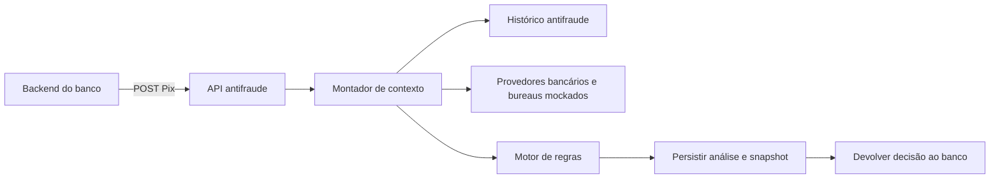
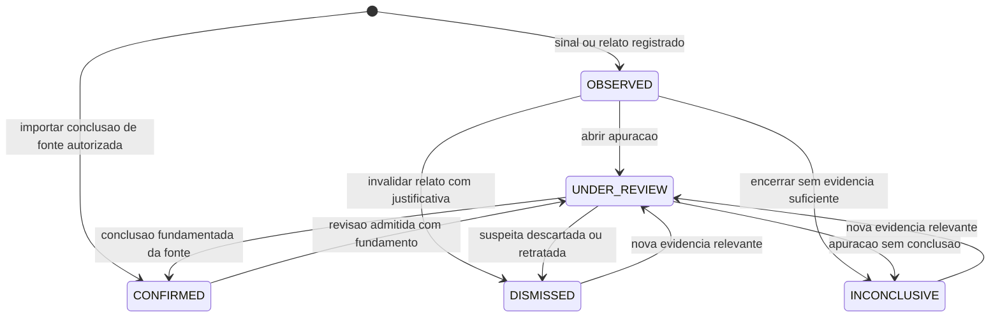

# Respostas às dúvidas de arquitetura e regras antifraude

17/10/2026. Propostas para decisão do grupo, anteriores à implementação. Complemento à [análise principal](ANALISE-ANTIFRAUDE-PIX.md).

Consideramos a orientação da organização, relatada pelo grupo, de que podemos simular consultas a outros sistemas e utilizar ideias probabilísticas. O contrato público continua com POST/GET de Pix e os três status. As fontes simuladas, os parâmetros e os exemplos deste documento são escolhas de projeto, não regras atribuídas à QI Tech ou ao Bacen.

**Revisão após esclarecimentos do grupo:** respostas [2](#q02), [7](#q07), [11](#q11), [12](#q12), [13](#q13) e [14](#q14) foram reescritas. A política por canal foi esclarecida como viável; a seção 12 agora contém o diagrama e as regras da máquina de estados.

## Leitura rápida

| Pergunta | Recomendação |
| --- | --- |
| [1. Separar banco e antifraude](#q01) | Separar responsabilidades; é viável ter duas APIs. Cada serviço escreve seus próprios dados. No hackathon, o banco pode ser apenas um provedor mockado. |
| [2. Preparação para interface low-code](#q02) | Catálogo com metadados/schemas, política serializável, validação, simulação e ativação de versões; a tela pode vir depois. |
| [3. Percentual da renda estimada](#q03) | Sinal auxiliar e incerto, nunca um limite universal ou gatilho isolado obrigatório de 2FA. |
| [4. IP versus geolocalização](#q04) | Comparação aproximada, preferencialmente em contextos selecionados, considerando qualidade e incerteza. |
| [5. Ticket do CNPJ](#q05) | Ajuda a contextualizar valores; não torna frequência ou montante anormais seguros. Também pode servir para vendedor com CPF. |
| [6. Solicitar confirmação no celular](#q06) | `two_factor_required` com motivo e ação sugerida em metadata, se for um reforço de autenticação que resolve o caso. |
| [7. Sensibilidade ao valor por canal](#q07) | Viável: faixas distintas por canal/contexto, mantendo perfil, exposição acumulada e limites bancários nos dois. |
| [8. Gradiente de confiança](#q08) | Regras independentes + composição por famílias + restrições prioritárias + tratamento explícito da falta de dados. |
| [9. Saldo insuficiente](#q09) | Responsabilidade do banco; antifraude pode usar saldo como contexto, mas não reserva nem movimenta recursos. |
| [10. Persistência e terceira tabela](#q10) | Transações e análises são o núcleo. A tabela de recebimentos HTTP é auditoria opcional, não outro histórico de Pix. |
| [11. Muitos pagadores e conta nova](#q11) | Política inicial por uso pessoal/comercial/desconhecido; envelopes de exposição e contexto independente, sem inventar histórico. |
| [12. Máquina de estados de suspeita](#q12) | Ocorrências: observada, em revisão, confirmada, descartada ou inconclusiva; restrições têm ciclo separado. |
| [13. Simultaneidade em PF](#q13) | Transações realmente simultâneas e incompatíveis são relevantes; distinguir de confirmação no celular, sequência próxima e operadores autorizados. |
| [14. Separação entre crédito e antifraude](#q14) | No Pix financiado, o motor de crédito cuida da concessão; o antifraude continua decidindo risco separadamente. |
| [15. Evento atrasado](#q15) | O horário informado da solicitação é anterior ao momento em que nossa API a recebe; guardar os dois. |
| [16. Segundo Pix durante viagem](#q16) | Consultar confirmação contextual aplicável; mesma localização ou novo POST não comprovam sucesso no desafio. |

<a id="q01"></a>

## 1. Separar a API antifraude da API do banco é viável? Usar a mesma API para escrita e leitura?

**Sim. A separação é viável e faz sentido como limite de responsabilidade.** Há três componentes diferentes:

| Componente | Responsabilidade | Dados que escreve |
| --- | --- | --- |
| Sistema/API do banco | Conta, sessão, autenticação, limites, saldo e execução financeira | Seus dados bancários e resultados de autenticação/pagamento |
| API antifraude | Receber Pix, montar contexto, decidir, persistir e consultar análises | Solicitações, análises, evidências e cópias identificadas dos sinais usados |
| Motor de regras | Avaliar um contexto pronto | Nenhum banco: devolve resultados para o orquestrador persistir |



**Sobre leitura e escrita: sim, a mesma aplicação antifraude pode atender as duas.** O POST grava a solicitação e a decisão; o GET consulta a decisão. Também é normal a API bancária ter operações de consulta e de alteração. Isso não exige serviços separados para leitura e escrita nem uma arquitetura de CQRS.

O ponto é quem controla cada dado. O antifraude não deve atualizar saldo, declarar sozinho que houve 2FA nem gravar diretamente nas tabelas internas do banco. Pode consultar um resultado confirmado e guardar uma cópia com a fonte. O banco não precisa escrever diretamente na tabela de análises: chama a API antifraude.

Se houver duas APIs reais, cada uma deve controlar suas tabelas. Podem compartilhar uma instância PostgreSQL com separação de schemas/permissões para a demonstração; compartilhar tabelas livremente mantém o acoplamento que queríamos evitar. Não manter transações bancárias abertas enquanto se espera uma chamada de rede de ida e volta.

**Recorte recomendado:** uma API antifraude com motor puro e provedores mockados locais. Uma segunda API bancária mínima é uma opção se ajudar a demonstração e houver tempo; não precisa reproduzir a aplicação da primeira fase inteira. Separar todo acesso a banco em uma API genérica de leitura/escrita apenas para tornar a API antifraude sem estado adicionaria chamadas e problemas de consistência sem benefício claro para o MVP.

<a id="q02"></a>

## 2. Como preparar o sistema para uma futura interface low-code?

**Sim: podemos implementar o motor com um contrato de configuração que uma interface visual consiga ler, editar, validar e publicar.** A pergunta é sobre preparar o backend para essa interface, não sobre construir a tela durante o hackathon. A proposta anterior ficou restrita demais à edição manual de parâmetros.

A separação central é: **a interface monta uma política como dados; o backend valida e executa essa política**. O motor não deve depender de componentes visuais nem receber código arbitrário do cliente.

### Componentes mínimos

| Componente | O que deve oferecer | Utilidade para a futura interface |
| --- | --- | --- |
| Catálogo de critérios | ID estável, versão, título, descrição, parâmetros tipados, unidade, limites e sinais necessários | Descobrir os blocos disponíveis e gerar os formulários |
| Documento de política | Versão do formato, regras escolhidas, parâmetros, combinações e efeitos | Salvar o que o cliente montou sem traduzir nomes de telas em código |
| Validador | Existência dos critérios, tipos/unidades, parâmetros válidos, combinações e permissões | Mostrar erros antes de ativar a política |
| Avaliador | Resolver os critérios do catálogo, avaliar o contexto e aplicar a composição | Executar a mesma política no teste e no POST real |
| Simulador | Avaliar cenários e mostrar regras acionadas, evidências e decisão | Permitir que o cliente entenda o efeito de uma alteração |
| Publicação/versionamento | Separar rascunho de versão ativa e registrar autoria/ativação | Evitar que editar uma regra mude análises em andamento sem controle |

Cada critério pode continuar sendo uma Strategy em Python. Além de `evaluate(context, parameters)`, ele expõe uma definição serializável dos parâmetros. Por exemplo, um valor monetário deve declarar inteiro em centavos; uma janela declara segundos. Campos obrigatórios, enums e propriedades permitidas podem ser descritos em JSON Schema, com validações de negócio adicionais no backend. [JSON Schema — objetos e propriedades](https://json-schema.org/understanding-json-schema/reference/object).

### Exemplo do documento que a interface poderia gerar

```json
{
  "schema_version": "1",
  "policy_id": "default",
  "policy_version": "demo-2",
  "rules": [
    {
      "id": "web_amount_step_up",
      "when": {
        "all": [
          {"criterion": "channel_is", "version": "1", "parameters": {"value": "internet_banking"}},
          {"criterion": "amount_above", "version": "1", "parameters": {"amount_cents": 100000}}
        ]
      },
      "effect": {"minimum_action": "two_factor_required"},
      "reason_code": "WEB_AMOUNT_REQUIRES_STEP_UP"
    }
  ]
}
```

É um **formato proposto**, não uma biblioteca ou parser já implementado. O limiar de R$1.000 é fictício para demonstrar configuração, não recomendação regulatória. `internet_banking` é um valor interno proposto: o contrato não fecha o enum de canais, então a normalização precisa ser documentada. Essa regra integra uma política completa; não define sozinha todas as aprovações.

A tela poderia mostrar “canal é internet banking” **E** “valor maior que R$1.000”, com efeito de exigir autenticação adicional. O motor executaria os IDs do catálogo e a operação `all`, independentemente da tela.

Para o MVP, basta suportar lista de critérios parametrizados e, se necessário para a demonstração, `all`/`any` com profundidade limitada. Não é preciso criar uma linguagem geral, editor de grafos ou aceitar expressões Python. Rejeitar IDs desconhecidos e configurações inválidas na publicação. Dado ausente não vira condição falsa automaticamente: critérios precisam representar `INSUFFICIENT_DATA`, e a composição deve ter tratamento explícito para esse estado.

### Publicação e execução

As operações de aplicação podem ser `get_catalog`, `validate_policy`, `simulate_policy` e `activate_policy`. Hoje podem ser chamadas por script ou CLI; depois, uma API administrativa poderá expô-las para a interface. **Isso prepara a integração sem acrescentar endpoints públicos de administração à entrega atual.**

O caminho de configuração é `rascunho → validação → simulação → ativação`. Ao iniciar uma análise, selecionar uma versão imutável da política. Guardar versão e hash junto ao resultado; alterações futuras não mudam essa análise. Para rollback, ativar explicitamente uma versão anterior compatível, sem apagar as versões publicadas.

Separar permissão para editar/publicar da permissão para enviar Pix. O cliente integrador configura dentro das opções autorizadas; o pagador não pode desligar regras no payload. Restrições obrigatórias da plataforma e precedência de rejeição não devem ser anuladas por uma regra de aprovação configurável. O simulador não grava Pix no histórico operacional.

**Recorte recomendado:** catálogo com metadados e schemas, política serializável, avaliador e simulação por fixtures. Acrescentar um critério totalmente novo ainda exige desenvolvimento; a interface low-code combina e parametriza capacidades já disponíveis. Isso atende ao objetivo de preparar a arquitetura para uma futura UI sem precisar entregá-la agora.

<a id="q03"></a>

## 3. Usar renda estimada e pedir 2FA acima de uma porcentagem é viável?

**Como sinal complementar, sim. Como regra automática isolada, eu evitaria.** Renda mensal não é saldo, patrimônio nem capacidade de fazer um pagamento pontual. Uma pessoa pode movimentar economias, vender um bem, receber uma transferência familiar ou transferir entre contas próprias.

O indicador pode ser calculado como `valor_do_pix / renda_mensal_estimada`, desde que a estimativa seja positiva, recente e acompanhada de fonte e qualidade. Ele mede exposição relativa à estimativa; não mede probabilidade de fraude. Se faltar renda ou a estimativa for zero, não dividir por zero nem tratar o cliente como suspeito.

**Uso proposto:** combinar exposição relativa elevada com valor fora do histórico, destinatário novo e mudança de acesso. Antes de usar renda, preferir o histórico de transações do próprio cliente quando houver amostra suficiente.

Exemplo: R$4.000 para uma pessoa com renda estimada de R$5.000 pode ser um aluguel recorrente normal. O mesmo valor, após recuperação de senha, em aparelho novo e para destino inédito, merece outra avaliação. A proporção é a mesma; o contexto é que muda.

Para o mock, devolver estimativa ou intervalo, período de referência, data e qualidade. Não usar bairro ou outros atributos pessoais como atalhos para inventar renda. Em PJ, faturamento, fluxo de caixa e perfil de pagamentos têm outra interpretação; não aplicar a mesma regra de salário.

**No MVP:** deixar como extensão. Se adotarem, o percentual é parâmetro experimental documentado e testado em cenários, não um teto oficial. Renda baixa não pode significar, por si só, baixa confiabilidade.

<a id="q04"></a>

## 4. Vale comparar o IP com a geolocalização, especialmente em aparelho novo?

**Sim, como sinal contextual de divergência, com tolerância.** A localização derivada do IP é aproximada: redes móveis, VPNs e proxies podem apontar para a infraestrutura de rede, e não para a pessoa. A MaxMind informa limitações e fornece raio de precisão em seus produtos. [Documentação de precisão da MaxMind](https://support.maxmind.com/knowledge-base/articles/maxmind-geolocation-accuracy).

O campo `geolocation` do payload também é uma localização informada: não sabemos se veio de GPS, navegador ou outra fonte, nem sua precisão. O mock de telemetria pode fornecer essas informações, mas precisa identificá-las como simuladas.

Fluxo proposto:

1. Acionar a comparação quando houver motivo, como dispositivo novo junto de valor atípico ou mudança de acesso; não fazer consulta externa cara em todo Pix sem necessidade.
2. Verificar se as duas localizações estão disponíveis e são comparáveis. IP sem cobertura, localização ausente ou precisão desconhecida reduzem a utilidade do sinal.
3. Comparar regiões ou distância considerando a incerteza. Diferença entre coordenadas exatas não basta.
4. Produzir uma evidência de inconsistência que se combina aos outros sinais, sem rejeição isolada.

Uma condição ilustrativa é `distância > raio_IP + raio_dispositivo + tolerância_da_política`, quando os raios forem conhecidos. Isso é uma heurística, não comprovação de falsificação. Não preencher raio ausente com zero. Localizações compatíveis também não provam legitimidade.

Exemplo: VPN corporativa em São Paulo e usuário em Recife não devem gerar bloqueio automático. Novo aparelho, recuperação de senha e discrepância relevante sem explicação conhecida podem aumentar o risco da família de acesso.

**Detalhe do teste:** o IP `198.51.100.23` do exemplo pertence a uma faixa reservada para documentação. Não esperar uma localização real dele; preparar fixture explícita. [RFC 5737](https://www.rfc-editor.org/rfc/rfc5737.html).

<a id="q05"></a>

## 5. O ticket médio do CNPJ ajuda? Se vários Pix estiverem nessa faixa, está tudo bem?

**Ajuda, mas estar na faixa de ticket não torna a sequência segura.** O ticket representa o tamanho habitual de cada recebimento; não responde se a quantidade de pagamentos ou a soma no período está normal.

Exemplo: uma loja recebe normalmente dez pagamentos de aproximadamente R$100 em cinco minutos. Receber quinhentos pagamentos de R$100 nesse intervalo preserva o ticket e altera muito a frequência e o montante. Pode ser uma promoção legítima ou atividade suspeita: precisamos de contexto.

Para a contraparte, calcular separadamente:

- Distribuição dos valores: mediana e percentis, além da média, para reduzir a influência de valores extremos.
- Quantidade de transações, soma e número de pagadores distintos em janelas comparáveis.
- Perfil por horário/dia, cobertura e tamanho da amostra.
- Novidade dos pagadores, recorrência e ocorrências independentes de segurança, quando disponíveis.

Usar histórico anterior, preferencialmente com status de execução conhecido. Não deixar a própria rajada elevar imediatamente o ticket e tornar-se seu próprio padrão de normalidade. Não misturar amostra de solicitações com pagamentos liquidados sem identificar a diferença.

**A regra vale para atividade comercial, não apenas CNPJ.** Um vendedor que recebe em CPF também pode ter perfil de vendas. Estar dentro do ticket reduz apenas a anomalia de valor; não anula outros sinais ou uma restrição aplicável à contraparte.

<a id="q06"></a>

## 6. Podemos pedir que a operação seja confirmada no celular quando superar um limite do internet banking?

**Sim, quando esse limite representar uma exigência adicional de autenticação.** Eu distinguiria duas situações:

| Situação | Tratamento proposto |
| --- | --- |
| A operação é permitida, mas exige confirmação em aparelho autorizado | `two_factor_required`, com motivo e indicação de confirmação no app |
| A operação excede um limite efetivo que permanece válido mesmo após autenticar | O banco impede a execução; trocar de canal ou concluir 2FA não deve contornar esse limite |

No primeiro caso, uma resposta possível, mantendo o envelope oficial, é:

```json
{
  "key": "68583a51-a551-4af2-85bf-4c15e9c25378",
  "status": "two_factor_required",
  "metadata": {
    "reason_codes": ["STRONG_AUTHENTICATION_REQUIRED"],
    "reason": "Confirme esta operação em um dispositivo autorizado.",
    "next_action": "confirm_on_registered_app",
    "policy_version": "demo-1"
  }
}
```

`next_action` é uma proposta nossa dentro de metadata; o banco precisa saber interpretá-la. Trata-se de decisão de negócio, não erro técnico nem quarto status.

É preferível confirmar **o mesmo Pix**, com valor e destinatário vinculados, em vez de pedir que o cliente refaça manualmente o pagamento e arrisque duplicidade. A confirmação no app precisa ser validada pelo banco, não apenas informada pelo cliente. A OWASP recomenda vincular autorização aos dados relevantes da operação e verificá-la no servidor. [OWASP — autorização de transações](https://cheatsheetseries.owasp.org/cheatsheets/Transaction_Authorization_Cheat_Sheet.html).

Com nossa idempotência, reenviar o POST original continua retornando a análise original. Nesse modelo, o banco conclui a operação condicionada após o desafio, e o provedor nos informa o resultado separadamente.

<a id="q07"></a>

## 7. É viável ser menos restritivo com valor no app e impor um limite no internet banking?

**Sim, com esse esclarecimento a abordagem é viável.** Vocês querem manter as demais verificações nos dois canais e variar a sensibilidade ao valor. Isso pode ser uma política parametrizada, e não uma aprovação automática de qualquer Pix no app.

Eu separaria três controles:

| Controle | Como usar |
| --- | --- |
| Limite financeiro/operacional efetivo | Continua valendo nos dois canais e é responsabilidade do banco; o antifraude não o amplia |
| Faixa de valor para aprovação sem reforço | Pode ser maior no contexto móvel autorizado e menor no internet banking, conforme a política de risco |
| Desvio de comportamento e exposição acumulada | Continua sendo analisado nos dois canais, mesmo abaixo da faixa nominal |

O benefício do app deve ter fundamento no contexto: por exemplo, dispositivo autorizado e mecanismo de autenticação adequado informado pelo banco. `channel=app` sozinho não comprova isso. Se a integração garantir essas propriedades, documentá-las; se os mocks indicarem aparelho novo sem autorização ou revogação, não aplicar o tratamento mais favorável. Browser com proteção equivalente pode receber faixa equivalente se essa for a política escolhida.

**Exemplo exclusivamente para demonstrar a ideia:** faixa sem reforço até R$5.000 em app com contexto verificado e até R$1.000 no internet banking. Um Pix de R$3.000 pelo browser exigiria confirmação adicional; o mesmo valor no app seguiria para avaliação normal de perfil, destino e frequência. Ainda poderia exigir 2FA ou ser rejeitado por esses sinais. Os números não são limites recomendados para produção.

### O que significa “impor um limite”?

- **Limiar de reforço:** acima dele, retornar `two_factor_required` se uma confirmação em aparelho autorizado resolver a exigência. O banco confirma o mesmo Pix, sem criar um pagamento duplicado.
- **Teto rígido do canal na política antifraude:** acima dele, a solicitação é rejeitada com motivo específico, independentemente de completar o desafio. A jornada de troca de canal precisa ser definida pelo banco; não sugerir que 2FA elimina o teto.
- **Limite bancário efetivo:** a execução deve ser impedida pelo banco enquanto não houver elegibilidade. Não é simplesmente um peso do score.

**Minha preferência para o hackathon é o limiar de reforço**, pois permite demonstrar sensibilidade por canal sem tratar um usuário legítimo do browser como fraudador. Se o grupo preferir teto rígido, é uma regra de negócio viável, mas precisa ficar explícito que é política própria e qual a ação esperada do chamador.

Implementar com parâmetros por perfil de acesso, como `amount_step_up_threshold_cents`. Aplicar o valor menor quando não houver evidência suficiente para o perfil mais permissivo. Continuar verificando valores muito acima do histórico e somas/frequências entre canais: dividir pagamentos ou alternar app e browser não deve reiniciar os controles por conta.

A OWASP descreve autenticação adaptativa conforme contexto de risco. Isso apoia ajustar o reforço ao contexto; os canais, valores e faixas acima continuam sendo desenho nosso. [OWASP — autenticação multifator e baseada em risco](https://cheatsheetseries.owasp.org/cheatsheets/Multifactor_Authentication_Cheat_Sheet.html).

<a id="q08"></a>

## 8. Gradiente de confiabilidade significa pesos, vários ifs ou outra abordagem?

**Eu usaria uma composição híbrida.** Condições (`ifs`) existem dentro de cada regra; pesos e precedências pertencem à política que combina seus resultados. O problema é espalhar decisões finais conflitantes por várias partes do código.

Separar dois eixos:

- **Risco observado:** quão preocupantes são as evidências disponíveis.
- **Qualidade/cobertura:** o quanto sabemos, de quais fontes e com que validade.

Pouca informação não é prova de fraude e também não pode produzir confiança máxima por omissão.

Sequência proposta:

1. **Restrições prioritárias:** por exemplo, aparelho explicitamente revogado ou restrição de contraparte vigente, conforme política definida. Não são compensadas por conta antiga ou bom ticket.
2. **Regras contextuais:** retornam evidências, disponibilidade e severidade, agrupadas em acesso, comportamento e contraparte.
3. **Composição:** limita a dupla contagem dentro de uma família e aplica pesos entre famílias. Combinações relevantes podem ter regra própria.
4. **Decisão:** aprovar quando o risco e a cobertura permitirem; pedir 2FA quando ele for adequado para resolver a dúvida; rejeitar quando houver impedimento ou risco que o desafio não resolva.

Uma fórmula possível para a parte gradual é `S = soma(peso_da_família × risco_da_família)`. Faixas e pesos precisam ser calibrados em cenários. Um score de 70 não significa 70% de probabilidade de fraude. Não aumentar artificialmente a aprovação renormalizando pesos quando uma fonte crítica falha.

Exemplo: aparelho novo e sessão nova podem descrever a mesma mudança de acesso, portanto não precisam somar duas penalidades máximas. Uma autenticação contextual aplicável reduz essa incerteza; não apaga uma restrição do recebedor. Evitar um único “saldo de confiança” em que muitos sinais favoráveis neutralizem qualquer problema.

**Implementação mínima:** regras Strategy + `RuleResult` + uma `DecisionPolicy` explícita e versionada. Não precisa de machine learning, rede neural nem motor genérico de expressões para demonstrar esse gradiente.

<a id="q09"></a>

## 9. Pix acima do saldo é responsabilidade do antifraude?

**A elegibilidade financeira pertence ao banco.** O antifraude responde sobre risco; `approved` não promete saldo, limite disponível ou execução bem-sucedida.

O banco pode fazer uma checagem preliminar de saldo/limites antes da análise para evitar trabalho desnecessário. Mesmo assim, precisa garantir disponibilidade no momento da execução, com o mecanismo de reserva/débito e concorrência que sua arquitetura adotar. Duas operações podem passar por consultas preliminares sobre o mesmo saldo.

Para nosso contrato de uso, propor: o integrador realiza validações financeiras e controla a execução; nossa decisão não reserva recursos. O antifraude pode usar proporção do saldo movimentada como sinal auxiliar, se o mock fornecer um snapshot, mas não trata insuficiência de saldo como confirmação de fraude.

Se uma solicitação chegar sem saldo, ainda podemos analisar seu risco. O banco continuará responsável por não executá-la. Não inventar `insufficient_balance` entre os três status oficiais do motor. Informações técnicas inválidas continuam no tratamento HTTP próprio; indisponibilidade financeira é um resultado do fluxo bancário, fora da decisão antifraude aqui proposta.

<a id="q10"></a>

## 10. Como persistir? Para que serve a terceira tabela de recebimentos?

**O núcleo precisa de uma solicitação de Pix e de sua análise.** A tabela de recebimentos distingue chamadas HTTP de transações de negócio; é opcional na modelagem que propusemos, não uma terceira tabela imposta pelo enunciado.

| Tabela proposta | Uma linha representa | Campos principais |
| --- | --- | --- |
| `pix_transactions` | Um Pix distinto aceito pelo schema | ID externo único no escopo do integrador, dados consultáveis, payload normalizado, hash canônico, `transaction_date`, `received_at` |
| `risk_analyses` | A análise persistida desse Pix | `key`, FK única da transação, status, motivos, versão da política, snapshot de contexto/evidências, instante da decisão |
| `request_receipts` — opcional | Uma tentativa de chamada ao POST | ID da chamada, horário, ID de Pix se disponível, referência à análise se houver, resultado do recebimento e código HTTP |

Exemplo concreto:

| Chamada recebida | Resultado | Novos Pix | Novas análises | Novos recebimentos, se a tabela existir |
| --- | --- | --- | --- | --- |
| Primeiro POST do Pix A | Analisa e grava | 1 | 1 | 1 |
| Mesmo Pix A, conteúdo equivalente | Recupera a resposta | 0 | 0 | 1 |
| Mesmo ID A, valor diferente | Conflito | 0 | 0 | 1 |
| Corpo inválido, sem ID utilizável | Erro de validação | 0 | 0 | 1, sem vínculo obrigatório com Pix |

**Quatro chamadas não viram quatro Pix.** Replays não aumentam frequência ou montante de negócio. Tentativas HTTP abusivas podem ter monitoramento separado. Se a tabela existir, registrar também o primeiro recebimento, não apenas os erros. Não copiar indiscriminadamente todo corpo inválido: guardar dados mínimos, hash/categoria e limites de tamanho, sem segredos.

A tabela de recebimentos não é obrigatória para devolver corretamente POST/GET; para o MVP, podemos começar com logs estruturados e as duas tabelas centrais. “Histórico de tudo que chegou” certamente exige preservar todos os Pix analisados, inclusive recusados e com 2FA; o material não define detalhadamente a persistência de JSON inválido. Essa interpretação deve ficar explícita no README.

**2FA é outro assunto de persistência:** se vamos importar resultados para próximas análises, usar `authentication_events` ou estrutura equivalente, deduplicada por provedor + ID do evento. Guardar vínculo, escopo, instante, validade, estado e fonte. Não usar `request_receipts` para isso. O snapshot da análise preserva o que se sabia naquele momento; o evento posterior não o reescreve.

Para reputação, ocorrências podem inicialmente vir das fixtures e ficar no snapshot; uma tabela própria só é necessária se formos gerir sua evolução, conforme a pergunta 12. Não criar um banco completo de contas/saldos para representar essas fontes.

Gravar Pix e análise na mesma transação PostgreSQL antes de responder. Usar restrições únicas para o ID externo e a relação 1:1, além de índices por pagador/data e destino/data. Coordenar leituras e gravações dos agregados sujeitos a concorrência. Falha no commit não autoriza responder que uma análise foi persistida.

<a id="q11"></a>

## 11. Como avaliar muitos pagadores para CPF, especialmente quando a conta é nova?

**Primeiro distinguir conta nova de histórico novo para nossa API.** Se a conta existe há anos e só é nova na nossa base, o provedor bancário pode trazer histórico anterior. Para uma conta realmente recém-aberta, não existe perfil individual suficiente: precisamos de uma política de início de relacionamento.

### Medidas observáveis desde o primeiro Pix

Por destinatário e janela, medir `N` (Pix distintos), `U` (pagadores distintos), `V` (soma solicitada), distribuição dos valores e tempo desde a abertura/primeira observação. Incluir a solicitação atual uma vez; não contar retries como pagamentos novos. Registrar cobertura: observar apenas os clientes de um integrador não equivale a conhecer todos os recebimentos da conta.

Para uma conta sem passado, não usar “cresceu infinitamente” nem dividir por média zero. Não faz sentido calcular porcentagem de pagadores novos como se fosse fraude: no primeiro dia, quase todos serão novos por construção.

### Política proposta para conta recém-aberta

1. **Buscar contexto independente:** uso pessoal ou comercial conhecido pelo banco, cadastro concluído, titularidade, reputação com estados e, quando disponível, atividade declarada e verificada. Esses dados podem ser mockados; a alegação “sou comerciante” sozinha não garante legitimidade.
2. **Escolher um perfil inicial:** pessoal, comercial ou desconhecido, com envelopes próprios de quantidade, montante e diversidade por janela. CPF não determina o perfil pessoal. Na ausência de informação confiável, assumir cobertura limitada.
3. **Usar faixas iniciais explícitas:** parâmetros de exposição para esse perfil, não falsos desvios de um histórico inexistente. Se houver dados representativos, podem derivar de contas comparáveis; no hackathon, são hipóteses justificadas por fixtures, não estatísticas reais inventadas.
4. **Combinar sinais:** exceder uma faixa produz evidência de risco/baixa cobertura; combinar com atividade declarada, ocorrências independentes, concentração temporal e outros indícios. Conta recente e muitos pagadores não bastam para afirmar fraude.
5. **Construir perfil gradualmente:** só substituir a política inicial após um período e volume de observação suficientes, com qualidade e variedade temporal. Uma rajada de pequenas operações não deve “treinar” imediatamente a própria aprovação.

Podemos ter configurações `new_personal`, `new_merchant` e `new_unknown`, com `max_count_without_extra_signal`, `max_requested_amount` e janelas definidas. Os nomes não exigem rejeição automática ao cruzar um limiar; a política de composição define a ação. Evitar colocar idade da conta, falta de histórico e pagadores novos como três penalidades máximas independentes para o mesmo fenômeno.

### Cenários de demonstração

| Conta/contexto | Situação | Interpretação proposta |
| --- | --- | --- |
| CPF recém-aberto de vendedor com atividade comercial simulada e verificada | Vários pagamentos pequenos compatíveis com a atividade | Pode ser aprovado se exposição e demais sinais permitirem; não exigir CNPJ para reconhecer comércio |
| CPF recém-aberto sem cobertura de atividade | Rajada com montante relevante | Maior incerteza; consultar reputação e contexto antes de definir resposta, sem fabricar perfil passado |
| CPF recém-aberto com restrição de destinatário vigente e aplicável | Qualquer ticket, mesmo habitual de comércio | Restrição prevalece segundo a política; 2FA dos pagadores não corrige o risco do destino |
| CPF conhecido com arrecadação eventual | Muitos pagadores inéditos | Pode ser legítimo mesmo com mudança de padrão; finalidade/contexto e outras evidências importam |

Não há limiar universal correto de pagadores. Precisamos escolher faixas demonstráveis e testar pares de cenários legítimos e suspeitos. O mock permite dar a dois casos com a mesma rajada contextos independentes diferentes, sem fazer o mock devolver a decisão pronta.

**Se só tivermos conta nova + muitos pagadores, sem outra evidência, não teremos certeza.** Pode haver uma política conservadora de exposição, explicitamente justificada, mas pedir 2FA ao pagador só trata dúvida sobre a autenticação dele. Quando a incerteza é exclusivamente sobre o destinatário, autenticar o pagador não torna a contraparte confiável. A política precisa decidir entre permitir sob exposição aceitável ou recusar por risco documentado; não há status de espera por analista no contrato.

Para contas com histórico, comparar `N`, `U` e `V` com janelas equivalentes e valores robustos. Entrada seguida de saída rápida só pode ser usada quando houver cobertura das saídas do destinatário; não é inferível apenas dos Pix que chegam à nossa API.

<a id="q12"></a>

## 12. Qual máquina de estados usar para suspeitas de fraude anteriores?

**Eu modelaria o estado de cada ocorrência, e derivaria a situação da conta a partir das ocorrências e restrições aplicáveis.** Uma conta pode ser vítima em um episódio, destinatária investigada em outro e ter uma ocorrência já descartada. Um único `account_is_fraud=true` perde essas diferenças.

A máquina abaixo é uma proposta interna para o protótipo, não o fluxo oficial do DICT. A decisão de cada Pix (`approved`, `two_factor_required`, `rejected`) permanece separada.

### 12.1 Estados da ocorrência



| Estado | Significado | Quem/evento pode produzi-lo | Efeito possível no motor |
| --- | --- | --- | --- |
| `OBSERVED` | Há um sinal ou relato registrado, ainda sem conclusão independente | Motor cria observação; provedor traz notícia/denúncia | Evidência limitada, com origem. Não confirma fraude nem gera bloqueio permanente |
| `UNDER_REVIEW` | A ocorrência está em apuração ou revisão formal | Serviço responsável ou evento mockado equivalente abre a apuração | Continua incerta. Uma restrição temporária só existe se emitida separadamente com fundamento |
| `CONFIRMED` | Uma fonte autorizada reportou conclusão fundamentada sobre o episódio | Provedor/investigação; nunca apenas o score do próprio motor | Evidência forte, respeitando papel da conta, alcance e vigência de eventual restrição. Não significa culpa judicial do titular |
| `DISMISSED` | A suspeita foi descartada/retratada com motivo | Responsável pela revisão ou fonte que corrige o relato | Essa ocorrência deixa de sustentar risco adverso; preservar histórico e corrigir restrições que dependiam só dela |
| `INCONCLUSIVE` | O caso foi encerrado sem elementos suficientes para concluir | Fonte responsável encerra a apuração; política pode arquivar observação não substanciada com motivo | Não é confirmação nem atestado de inocência. Evitar penalidade permanente; validade e peso residual devem ser explícitos, podendo ser zero |

**Não há estado `CLEAN` da pessoa.** Ausência de ocorrência com boa cobertura significa “nenhuma ocorrência conhecida nesta fonte”; fonte indisponível ou cobertura desconhecida é outra situação.

Não é necessário esperar um analista para responder ao Pix. O motor usa o estado já conhecido no instante da análise; as transições posteriores são eventos externos simulados. A implementação de investigação humana não faz parte do hackathon.

### 12.2 Regras das transições

- Uma recusa local pode criar `OBSERVED`, deduplicada e ligada às evidências originais. Rejeitar repetidamente não promove o caso a `CONFIRMED` e não gera evidências independentes novas.
- `CONFIRMED` exige fonte e conclusão identificáveis. Uma fixture pode simular isso; o sistema não afirma que consultou o DICT real.
- Importar caso já confirmado permite iniciar em `CONFIRMED`, preservando ID, versão e origem do caso externo. Não inventar uma investigação feita por nossa equipe.
- Reabrir `DISMISSED`, `INCONCLUSIVE` ou `CONFIRMED` exige nova evidência ou revisão formal justificada. O pedido de contestação isolado não apaga a conclusão nem remove automaticamente uma restrição.
- Ao reabrir um caso confirmado, registrar a conclusão anterior e o motivo da revisão. Enquanto não houver correção fundamentada, a restrição continua seguindo seu ciclo próprio.
- Prazo vencido ou provedor fora do ar não transforma suspeita em confirmação. Não criar cancelamento/expiração automática para marcações externas quando sua fonte não prevê esse efeito.

### 12.3 Restrição é uma segunda dimensão

O estado do caso descreve **o que se sabe**. A restrição descreve **o que pode ser feito agora**. Proposta mínima para cada restrição:

| Estado da restrição | Significado |
| --- | --- |
| `ACTIVE` | Controle vigente, com motivo, escopo, ações afetadas, fonte e condições de término |
| `REVOKED` | Controle retirado por evento autorizado, preservando motivo e histórico |
| `EXPIRED` | Prazo explicitamente definido para aquela restrição terminou; não significa que a ocorrência foi descartada |

Sem controle emitido, não há registro de restrição. Uma restrição nova começa em `ACTIVE` e pode ir para `REVOKED` ou `EXPIRED`; reativação exige nova emissão/versão, não reabrir silenciosamente o registro encerrado. Nem toda restrição tem prazo automático. Um controle provisório durante `UNDER_REVIEW` pode vencer sem encerrar o caso; um episódio `CONFIRMED` pode continuar registrado mesmo depois de a conta ser recuperada e a restrição ser retirada.

Ao descartar uma ocorrência, revisar/revogar controles baseados exclusivamente nela. Se houver outra ocorrência válida sustentando a restrição, ela não deve desaparecer por engano. O protótipo pode usar vínculo explícito entre cada restrição e seus fundamentos.

### 12.4 Persistência e cálculo por conta

Uma modelagem possível é `risk_cases` para o estado atual da ocorrência e `risk_case_events` para as transições. Cada evento guarda ID da fonte, versão/ordem, estado anterior/novo, motivo, evidências, ator responsável, instante do fato e instante de recebimento. Atualizar estado e registrar evento atomicamente; deduplicar eventos e impedir que uma versão antiga restaure estado superado.

Se as restrições forem implementadas, `risk_restrictions` guarda controle, alcance e fundamento. Para o MVP, essas estruturas podem começar como fixtures versionadas e snapshots persistidos; não é obrigatório construir um sistema administrativo inteiro.

A avaliação de uma conta segue a ordem: resolver identidade/escopo → consultar ocorrências e cobertura → verificar restrições aplicáveis → compor as demais evidências. Não resumir por “último estado recebido”: um caso descartado não anula outro confirmado. Tampouco estender automaticamente uma ocorrência de uma conta a todas as contas do documento.

**Exemplo:** rajada gera `OBSERVED`; serviço externo inicia `UNDER_REVIEW`; simulação demonstra comércio legítimo e encerra em `DISMISSED`. A observação deixa de penalizar o vendedor, mas permanece auditável. Em outro cenário, a fonte confirma tomada de conta: `CONFIRMED` descreve o episódio; o titular pode ser vítima. Após recuperação, uma restrição pode ser revogada sem apagar o fato histórico.

O BC também distingue notificações, marcações e cancelamentos. Essa referência motiva preservar origem e evolução, mas os estados acima são nossos e não equivalem aos códigos do DICT. [BC — marcações de fraude](https://www.bcb.gov.br/estabilidadefinanceira/pix-seguranca), [API DICT](https://bcb.gov.br/content/estabilidadefinanceira/pix/API-DICT.html).

<a id="q13"></a>

## 13. Quando uma PF poderia operar mais de um dispositivo simultaneamente sem ser fraude?

**Concordo com a preocupação: transações realmente simultâneas de uma mesma conta PF em dispositivos diferentes são um sinal relevante, especialmente em locais incompatíveis.** Minha resposta anterior precisava distinguir ter vários aparelhos de efetivamente iniciar Pix concorrentes neles. Isso merece avaliação; não implica automaticamente fraude confirmada.

### Situações que precisam ser separadas

| Situação possível | O que ela explica — e o que não explica |
| --- | --- |
| Pix iniciado no computador e confirmado no celular | Uma operação usa dois dispositivos. Não são dois Pix; a confirmação deve chegar como evento vinculado, sem duplicar a solicitação nem mudar seu payload em retry |
| Duas transferências feitas em sequência próxima, uma no computador e outra no celular | Podem cair na mesma janela de minutos, especialmente se as chamadas atrasarem. Isso não equivale a presença física simultânea em países diferentes |
| Conta conjunta ou acesso por representante, quando o banco permitir e identificar atores autorizados | Dois operadores podem agir legitimamente. Precisamos de contexto explícito de titularidade/permissão; não assumir isso só por ser CPF |
| Operações previamente programadas ou automação autorizada pelo banco | Podem produzir processamento concorrente sem duas ações humanas naquele instante. Essa origem precisa ser comprovada pelo integrador; não inferi-la neste payload |
| Duas sessões apenas abertas | Não explica dois pagamentos simultâneos; sessão ociosa não é atividade transacional |

Os casos são possibilidades condicionadas às funcionalidades e permissões da instituição, não afirmação de que qualquer conta permite compartilhar acesso. Uso da senha por familiares não é uma evidência suficiente de autorização.

**Para a conta individual de um único operador, dois Pix efetivamente originados em segundos de aparelhos diferentes e localidades confiáveis incompatíveis são bem mais preocupantes** que duas sessões abertas ou dois dispositivos cadastrados. Se os locais vierem apenas de IP, considerar VPN e precisão antes de afirmar impossibilidade física.

### Regra proposta

1. Agrupar solicitações distintas da mesma conta pagadora, deduplicando reenvios; confirmação de 2FA é outro evento, não outro Pix.
2. Medir intervalo, dispositivos distintos e qualidade das localizações. Registrar se comparamos tempo do evento ou de chegada.
3. Consultar cadastro dos aparelhos e, se disponível, atores/sessões autorizados e natureza da operação.
4. Combinar simultaneidade anômala com aparelho não autorizado, recuperação de conta, destinos inéditos, exposição e deslocamento incompatível.
5. Aplicar ação proporcional: 2FA para uma dúvida de acesso que o desafio resolva; rejeição para restrição ou combinação severa. Um caso legítimo explicado ainda passa por frequência, montante e contraparte.

**Podemos definir contribuição maior para essa combinação em PF de operador único**, enquanto PJ com operadores comprovadamente autorizados tem um perfil esperado diferente. O motivo é a estrutura de autorização e comportamento, não simplesmente o texto CPF/CNPJ. Sem dados de operadores, não conceder automaticamente à PJ a explicação favorável. Assim, não recomendo “negar PF e sempre pedir 2FA para PJ”, mas concordo em tratar simultaneidade incompatível como sinal forte para ambos.

O payload não identifica operadores e não comprova presença física; o mock pode fornecer esses vínculos. Não inventar identidade de sessão a partir de `device_id`. Além disso, muitos compradores em aparelhos e localidades diferentes pagando uma pessoa não são múltiplos acessos à conta dela: IP e localização pertencem à origem de cada Pix.

A API decide sobre a solicitação atual. Encerrar sessões, bloquear uma conta inteira ou interromper outras operações pendentes são ações do banco; não confundir isso com alterar retroativamente análises já respondidas.

<a id="q14"></a>

## 14. No Pix financiado, o histórico de crédito deve ficar com outro motor?

**Sim. Essa é a separação que eu recomendo.** Entendendo “Pix no crédito” como uma operação em que a instituição oferece uma fonte de financiamento, a análise de crédito avalia a concessão e suas condições; o antifraude avalia o risco de uso indevido ou golpe. A aprovação de um não substitui a do outro.

| Responsável | Pergunta que resolve |
| --- | --- |
| Cadastro/autenticação do banco | Quem é o cliente/operador e ele está autorizado a operar a conta? |
| Motor de crédito | A instituição oferece esse financiamento? Qual limite e quais condições? |
| Motor antifraude | A operação tem sinais de fraude? Pode prosseguir, exige reforço ou deve ser recusada? |
| Orquestrador financeiro | Há recursos ou limite de crédito disponível, autorização válida e condições para executar uma única vez? |

Para um Pix que usa saldo, elegibilidade de crédito pode nem entrar no fluxo. Para uma operação financiada, o banco precisa combinar crédito aprovado, limite disponível, aceite das condições e autorização da operação com a decisão antifraude. A origem dos recursos muda; a necessidade de verificar fraude permanece.

Fluxo conceitual: autenticação/validações iniciais → avaliação de crédito quando aplicável → antifraude → eventual 2FA → verificação final/reserva e execução pelo banco. A ordem entre consultas pode variar ou ser parcialmente paralela, mas uma concessão preliminar não deve desembolsar antes das demais condições. O banco controla consistência, expiração, reserva e reenvios.

**Não precisamos consultar score de crédito para este MVP antifraude.** Renda estimada, se usada na pergunta 3, seria um sinal opcional de exposição, não decisão de capacidade de pagamento. Nem crédito aprovado garante legitimidade, nem crédito recusado significa fraude.

O payload oficial não informa modalidade de financiamento, parcelamento ou condições de crédito. Por isso, essa divisão pode ser documentada como responsabilidade da aplicação bancária e representada em mock, sem criar outro motor real ou acrescentar campos obrigatórios ao POST. O banco pode fornecer elegibilidade financeira no contexto se houver uso definido; não é necessário para executar as regras centrais.

### O que continua valendo sobre autenticação e liveness

Podemos adotar como pré-condição que a chamada vem do backend autorizado e que o usuário tem sessão válida e permissão para a conta. O onboarding pode ter incluído liveness conforme a política da instituição, mas isso não comprova presença atual nem autorização específica do Pix. Crédito e liveness são fatos diferentes, com finalidades diferentes.

O NIST distingue comprovação de identidade, autenticação e continuidade da sessão. Isso sustenta separar cadastro passado de acesso atual; não é uma exigência de implementar integralmente esse padrão no hackathon. [NIST — identidade digital](https://pages.nist.gov/800-63-4/sp800-63.html), [NIST — sessões](https://pages.nist.gov/800-63-4/sp800-63b/session/).

Proposta revisada de cláusula para o README:

> O integrador é responsável pelo cadastro, autenticação e autorização do usuário/operador, pelas validações financeiras e pela execução do pagamento. Quando houver financiamento, concessão e disponibilidade de crédito são responsabilidade do domínio de crédito. O motor antifraude avalia separadamente o risco da transação e pode exigir autenticação adicional ou recusar a operação. Aprovação de crédito e liveness realizado no cadastro não constituem aprovação antifraude.

<a id="q15"></a>

## 15. O que significa evento atrasado no tópico 11?

**É uma solicitação que chega depois do horário em que o sistema de origem diz que ela foi criada.** Não significa que o Pix já foi executado. Rede, fila interna ou reenvio do integrador podem causar atraso ou inversão da ordem de chegada.

Exemplo, todos no mesmo fuso:

| Pix | `transaction_date` informado | `received_at` na API |
| --- | --- | --- |
| B | 14:03 | 14:03:01 |
| A | 14:00 | 14:05:00 |

Analisamos B antes de A, embora A tenha data anterior. Se a regra de A mede os cinco minutos anteriores ao horário do evento, sua janela proposta é `(13:55, 14:00]`: B não pertence a essa janela. Incluir a intenção atual uma vez; para eventos com timestamps iguais, usar a ordem de recebimento/serialização para considerar os já conhecidos.

O histórico usado em uma decisão também é limitado ao que já era conhecido quando ela foi tomada. A chegada posterior de A não faz o GET de B recalcular silenciosamente a decisão. Preservar o snapshot é o que permite explicar esse resultado.

**Ajuste importante à leitura do documento principal:** tempo do evento serve para o comportamento histórico, mas não deve ser a única barreira de segurança. Um atacante não pode escapar das proteções mandando uma data antiga. Podemos manter uma janela separada de chegadas por `received_at`, validar atrasos/futuro segundo tolerância documentada e considerar revogações/restrições vigentes no momento da avaliação operacional. Em uma reprodução histórica, usar apenas informações disponíveis no corte daquela simulação; não confundir isso com uma autorização ao vivo.

Para o MVP, guardar os dois horários, documentar as fronteiras das janelas e testar ordem invertida. Uma tolerância rígida, se adotada, é escolha nossa e deve ser compatível com os cenários do evento. Não rejeitar indiscriminadamente o payload de exemplo por divergência com o relógio do teste. Eventos de autenticação e reputação também podem chegar atrasados: preservar instante de ocorrência e de conhecimento, sem sobrescrever estados novos com eventos antigos.

<a id="q16"></a>

## 16. Depois de pedir 2FA por uma localização estranha, como analisar o segundo Pix dali?

**Consultar o resultado no provedor e verificar o que exatamente foi confirmado.** A segunda solicitação não prova que a primeira passou pelo desafio; a localização repetida também não.

Fluxo proposto para demonstrar:

1. O Pix A chega de um contexto de acesso diferente e recebe `two_factor_required` por uma combinação de sinais.
2. O banco realiza o desafio e registra seu resultado vinculado ao Pix A. Uma fixture simula esse evento.
3. Se a política do banco prevê isso, o provedor também registra uma sessão/contexto de autenticação recente com escopo explícito e validade. Esse registro é distinto da autorização exclusiva do Pix A.
4. Ao receber o Pix B, a montagem do contexto consulta os sinais e persiste a confirmação com deduplicação.
5. O motor verifica conta, dispositivo, vínculo com a sessão/contexto, validade, revogação e compatibilidade da situação atual. Se aplicável, reduz a incerteza que motivou o desafio anterior.
6. O Pix B ainda passa pelas regras de valor, frequência, exposição e contraparte. Uma diferença relevante pode exigir outro desafio ou rejeição.

O payload não traz `session_id`: o provedor precisa conseguir resolver o vínculo usando o Pix e os dados disponíveis no backend. Para o hackathon, usar mapeamento explícito nas fixtures. Se houver duas sessões possíveis e não for possível saber qual originou a operação, não transferir confiança arbitrariamente por coincidência de localização ou de aparelho.

| O que o provedor sabe | Efeito na análise do Pix B |
| --- | --- |
| Sucesso restrito à autorização do Pix A | Não autoriza B nem reutiliza o código/desafio de A |
| Autenticação contextual válida e aplicável | Pode evitar novo 2FA apenas pela mesma mudança geográfica |
| Pendente, falha, revogação, expiração ou informação sem vínculo seguro | Não conceder o benefício de confiança; avaliar a nova solicitação com a incerteza registrada |
| Confirmação válida, mas novo valor extremo ou destino com restrição | Avaliar o novo risco; confirmação anterior não é aprovação geral |

Sessão autenticada e autorização de pagamento têm papéis distintos: o NIST descreve continuidade de sessão com prazo; a OWASP recomenda proteger e vincular a autorização à operação. Usamos a primeira para evitar repetir fricção sem motivo, sem reciclar a autorização de um Pix em outro. [NIST — sessões](https://pages.nist.gov/800-63-4/sp800-63b/session/), [OWASP — autorização de transações](https://cheatsheetseries.owasp.org/cheatsheets/Transaction_Authorization_Cheat_Sheet.html).

Não guardar simplesmente `trusted_location=true` nem `last_2fa_success=true` sem escopo e validade. Não transformar uma aprovação em marcação permanente de aparelho confiável. Prazo de confiança e gatilhos de revogação são parâmetros da política, a justificar e testar; não há um prazo universal definido aqui.

Por fim, o Pix A continua com sua análise original consultável como `two_factor_required`, enquanto o resultado de autenticação fica registrado separadamente. O banco pode ter executado A, mas isso exige outro dado de confirmação. O Pix B é uma nova análise com novo snapshot; o replay de A continua idempotente.

## Recorte recomendado para implementação

Implementar o contrato oficial, persistência central e motor plugável, com três conjuntos de mocks: **segurança de acesso, histórico bancário e contraparte**. Preparar a configuração versionada para uma futura interface low-code, com catálogo, validação e simulação. Demonstrar troca de aparelho, viagem, primeiro Pix com histórico externo, vendedor CPF legítimo e sequência com sinais fortes de tomada de conta/risco de destino.

Renda estimada, saldo como contexto, telemetria avançada e editor visual são extensões. As decisões finais de regra, os valores dos parâmetros e os formatos internos precisam ser refletidos no README e nos testes. Este documento responde às dúvidas e propõe escolhas; não afirma que essas funcionalidades já foram implementadas ou que todos os exemplos foram aprovados pela organização.
